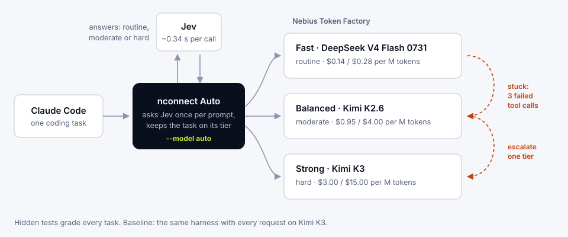

# Open Source Models via Nebius Token Factory

A Jev-routed coding benchmark. Jev picks a model tier for each coding task, and [nconnect](https://nconnect.sh) routes Claude Code to DeepSeek V4 Flash 0731, Kimi K2.6 or Kimi K3 on Nebius Token Factory. The benchmark compares that with running every request on Kimi K3.

Inspired by Abdul's [Jev router experiment](https://github.com/amrrs/jev-router-experiment), which routes one-shot prompts. This one tests the same idea inside a coding agent, where one task is dozens of model calls, tool use and file edits.



## Run

Requires macOS, Bun, Node 24, Python 3.11 and Claude Code 2.1.299. Set `NEBIUS_API_KEY` and `TYPESAFE_API_KEY` in your environment or a gitignored `.env.local`.

```sh
python3 bench/run.py prepare --run-id v2 --conditions C --catalog-from main
python3 bench/run.py run --run-id v2
```

The benchmark makes paid API calls. Grading is offline: hidden tests the agent never sees. Full setup, every command and the evidence layout are in [docs/RUNNING.md](docs/RUNNING.md).

## Results

[50-task report](reports/v2/report.md) · [Per-task CSV](reports/v2/per-task.csv) · [Tasks](dataset/tasks) · [Protocol](docs/PROTOCOL-V2.md) · [Abdul-task report](reports/abdul/report.md) · [Raw evidence](runs)

**50 coding tasks** (Python, TypeScript, JavaScript; 20 easy, 20 medium, 10 hard):

| | Fixed Kimi K3 | Auto + Jev |
|---|---|---|
| Passed hidden tests | 42 / 50 | 40 / 50 |
| Total cost | $36.79 | **$27.93 (−24%)** |
| Cost per passed task | $0.88 | **$0.70** |
| Cheaper on | | 39 of 50 tasks |

One run per task: neither the cost gap nor the 2-task pass gap is statistically significant (McNemar p = 0.73). Auto took about twice as long per task (median 52 s against 25 s).

**Where the saving comes from:**

| | Tasks | Fixed Kimi K3 | Auto + Jev |
|---|---|---|---|
| Never needed Kimi K3 | 35 | 30 passed, $22.39 | 28 passed, **$4.06 (−82%)** |
| Jev sent straight to Kimi K3 | 4 | 2 passed, $4.84 | 2 passed, $5.98 |
| Escalated to Kimi K3 mid-task | 11 | 10 passed, $9.56 | 10 passed, $17.89 |

**The 32 tasks where Auto passed and spent less** ([CSV](reports/v2/routing-wins-32.csv)): $25.30 → $5.45, **−78.5%**.

| Task type | Tasks | Saving |
|---|---|---|
| API changes | 3 | 95% |
| Formatting | 4 | 93% |
| Utilities | 3 | 92% |
| Validation | 5 | 87% |
| Bug fixes | 3 | 84% |
| Features | 4 | 79% |
| Refactors | 4 | 66% |
| Parsing | 4 | 60% |
| State and concurrency | 2 | 50% |

**Abdul's 30 tasks** (extraction, classification, source lookup and policy; his prompts and his `equal()` grader):

| | Fixed Kimi K3 | Auto + Jev |
|---|---|---|
| Wrote the correct `answer.json` | 24 / 30 | **29 / 30** |
| Correct answer anywhere (lenient)* | 30 / 30 | 29 / 30 |
| Total cost | $1.49 | **$0.10 (−93%)** |

\*Kimi K3 often printed the answer instead of writing the file. The lenient score, added after seeing that, counts a correct JSON answer in the final message ([script](bench/abdul_lenient.py), [rows](reports/abdul/lenient.json)). Jev called all 30 tasks routine, so every one ran on DeepSeek V4 Flash 0731.

**The router itself:** 101 Jev calls across the 50 coding tasks cost $0.0024 in total, median 342 ms each.

## What was compared

| | Fixed | Auto + Jev (condition C) |
|---|---|---|
| Harness | Claude Code 2.1.299 | Claude Code 2.1.299 |
| Router | nconnect 0.23.0, `--model moonshotai/Kimi-K3` | nconnect `12ad392` (shipped in 0.24.0), `--model auto` |
| Models | Kimi K3 | DeepSeek V4 Flash 0731 / Kimi K2.6 / Kimi K3 |
| Decider | none | `jev-1.13.0`, once per prompt |

Both used the same pinned Nebius prices, limits, permissions and hidden tests. Cached input is billed at the full input rate. The protocol for each run was committed before the run; see the git history.

`reports/main` is the first run (Auto v1 on nconnect 0.23.0: 48/50 passed, $37.09, no saving). Its analysis led to the v2 changes, documented in [PROTOCOL-V2](docs/PROTOCOL-V2.md).

## Charts

```sh
python3 -m venv vendor/analysis-venv
vendor/analysis-venv/bin/pip install -r requirements-analysis.lock
vendor/analysis-venv/bin/python bench/report.py --run-id v2 --auto-condition C --fixed-from main --out v2
```

Charts are in [`reports/v2/charts`](reports/v2/charts) and [`reports/abdul/charts`](reports/abdul/charts).

## Credits

The 30 tasks in `abdul/` and their grading rule come from [amrrs/jev-router-experiment](https://github.com/amrrs/jev-router-experiment) at commit `56b4c3b`. Jev is by [TypeSafe](https://typesafe.ai). Models are served by [Nebius Token Factory](https://tokenfactory.nebius.com).
