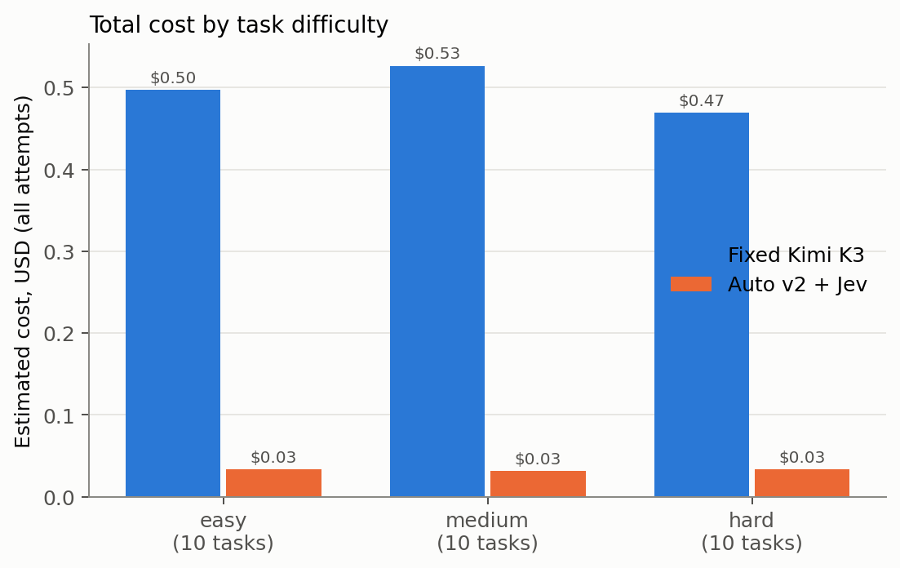
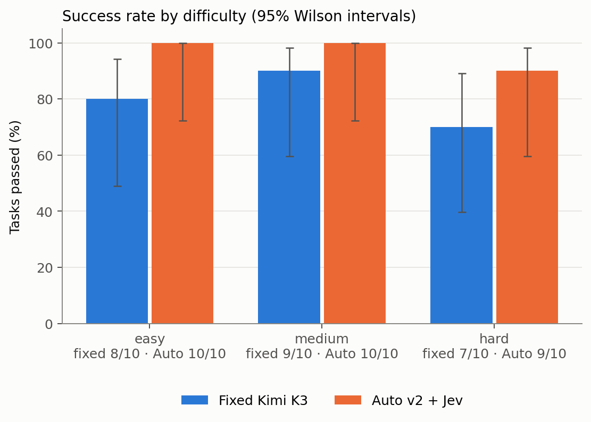
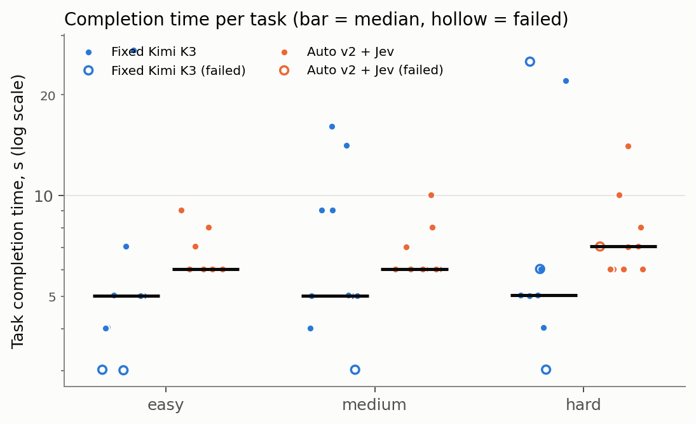
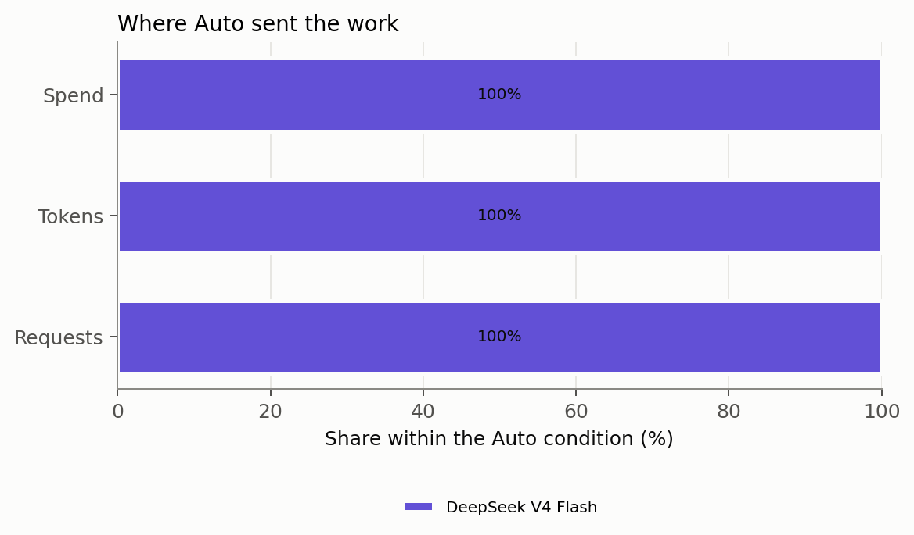
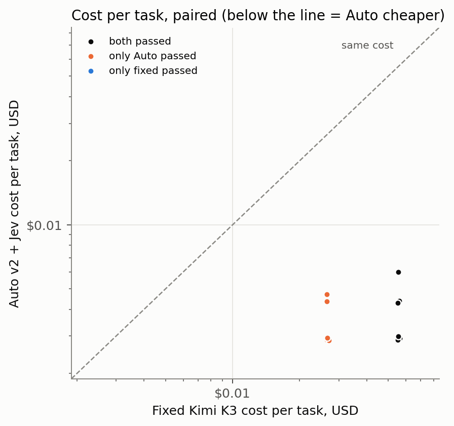

# Results: abdul

Generated from `runs/abdul/` by `bench/analyze.py` and `bench/report.py`. Every number below can be traced to
`results.jsonl` and the raw files of the execution named in the per-task table.

- Condition A taken from: `runs/abdul/`; condition C from `runs/abdul/`.
- Executions: 60 (task executions; each makes many model API requests, counted separately below).
- nconnect v0.23.0 (bundle `db122e275473…`, source `66bf93f`), 2.1.299 (Claude Code), Node v24.18.1, Python 3.11.5.
- Condition C runs its own nconnect build: `vendor/nconnect-0.23.0-autov2.2.js` (sha256 `1e392f7eb140…`, source `12ad392`).
- Prices: Nebius catalog captured 2026-10-15T13:46:55.417Z; Jev jev-1.13.0 at $0.042/M input tokens.
- Costs are **estimates** from provider-reported tokens and those prices, not reconciled against Nebius billing. Cached input
  is charged at the full input rate (Nebius publishes no cached price); the cache-free lower bound is shown alongside.
- Run events: prepared; run started; provider unhealthy; waiting; provider unhealthy; waiting; provider unhealthy; waiting; provider unhealthy; waiting; run complete.

## Headline (paired tasks)

- Paired tasks: **30**.
- Quality: Auto minus fixed = **+16.7 percentage points** [+0.0, +33.3] (bootstrap 95% CI). Exact McNemar p = 0.125 on 7 discordant pairs.
- Cost: fixed $1.49, Auto $0.0990. Savings **93.4%** [92.4%, 94.1%], i.e. a cost-reduction factor of **15.08×** ($1.39 saved). Auto was cheaper on 30 of 30 tasks.
- Time: total fixed 3.8 min, Auto 3.5 min; speedup by total time **1.09×**, by median 0.83×, geometric mean over the 23 tasks both passed 1.01× [0.80×, 1.29×]. Auto was faster on 6 of those 23.
- Speedup above 1× means Auto finished faster; below 1× means slower.

## Excluded executions (Amendments 1 and 2)

No execution met the infrastructure-failure rule.

## Scorecard

| Metric | A: fixed Kimi K3 | C: Auto v2 + Jev |
|---|---|---|
| Tasks passed | 24/30 | 29/30 |
| Success rate (95% CI) | 80.0% [62.7%, 90.5%] | 96.7% [83.3%, 99.4%] |
| Total execution cost, estimated (incl. failed tasks) | $1.49 | $0.0990 |
|   of which foreground inference | $1.49 | $0.0978 |
|   of which background calls | $0.0000 | $0.0000 |
|   of which Jev routing | $0.0000 | $0.0012 |
|   of which unmetered (estimated from bytes) | $0.0000 | $0.0000 |
|   spent on failed tasks | $0.1597 | $0.0030 |
| Lower bound if cached input were free | $0.4730 | $0.0456 |
| Average cost per attempted task | $0.0498 | $0.0033 |
| Cost per successful task | $0.0622 | $0.0034 |
| Successful tasks per dollar | 16.1 | 292.9 |
| Successful tasks per hour (one at a time) | 375.2 | 494.4 |
| Median completion time | 5.0 s | 6.0 s |
| p95 completion time | 24 s | 10 s |
| Median time to first output | 2.4 s | 2.8 s |
| Total wall time | 3.8 min | 3.5 min |
| Input tokens (cached share) | 479,182 (71%) | 670,139 (57%) |
| Output tokens (reasoning reported) | 3,715 (0) | 14,161 (7,948) |
| Tokens per task / per success | 16,097 / 20,121 | 22,810 / 23,597 |
| Model requests per task | 1.8 | 2.3 |
| Tool calls per task | 0.8 | 1.3 |
| Failed tool calls | 0 | 1 |
| Upstream retries / errors / without usage | 0 / 0 / 0 | 0 / 0 / 0 |
| Sessions stopped by a limit | none | none |
| Auto escalations (tasks with stuck → strong) | n/a | 0 (0 stuck routes) |
| Anomalies / contamination flags | 0 / 0 | 0 / 0 |

## Paired outcomes

| Tasks | Both pass | Only fixed passes | Only Auto passes | Both fail | McNemar p |
|---|---|---|---|---|---|
| all | 23 | 1 | 6 | 0 | 0.125 |
| easy | 8 | 0 | 2 | 0 | 0.500 |
| medium | 9 | 0 | 1 | 0 | 1.000 |
| hard | 6 | 1 | 3 | 0 | 0.625 |

## By difficulty

| Difficulty | Tasks | Passed A / B | Cost A / B | Savings | Cost per success A / B | Median time A / B |
|---|---|---|---|---|---|---|
| easy | 10 | 8 / 10 | $0.4973 / $0.0337 | 93% | $0.0622 / $0.0034 | 5.0 s / 6.0 s |
| medium | 10 | 9 / 10 | $0.5265 / $0.0317 | 94% | $0.0585 / $0.0032 | 5.0 s / 6.0 s |
| hard | 10 | 7 / 9 | $0.4695 / $0.0336 | 93% | $0.0671 / $0.0037 | 5.0 s / 7.0 s |

## By category

| Category | Tasks | Passed A / B | Cost A / B | Savings | Cost per success A / B | Median time A / B |
|---|---|---|---|---|---|---|
| classification | 9 | 7 / 8 | $0.4399 / $0.0260 | 94% | $0.0628 / $0.0032 | 5.0 s / 6.0 s |
| extraction | 10 | 9 / 10 | $0.5304 / $0.0304 | 94% | $0.0589 / $0.0030 | 6.0 s / 6.0 s |
| policy | 5 | 3 / 5 | $0.2193 / $0.0205 | 91% | $0.0731 / $0.0041 | 5.0 s / 10 s |
| source_lookup | 6 | 5 / 6 | $0.3037 / $0.0221 | 93% | $0.0607 / $0.0037 | 5.0 s / 7.5 s |

## Where the work and the money went

| Condition | Model | Requests (share) | Tokens (share) | Spend (share) |
|---|---|---|---|---|
| A | moonshotai/Kimi-K3 | 54 (100%) | 482,897 (100%) | $1.49 (100%) |
| C | deepseek-ai/DeepSeek-V4-Flash-0731 | 68 (100%) | 684,300 (100%) | $0.0978 (100%) |

## Auto's routing

First tier Auto chose for each task, by the evaluator's difficulty label (a diagnostic, not a quality measure):

| Difficulty | fast | balanced | strong | none |
|---|---|---|---|---|
| easy | 10 | 0 | 0 | 0 |
| medium | 10 | 0 | 0 | 0 |
| hard | 10 | 0 | 0 | 0 |

Jev's own choice on the task prompt:

| Difficulty | routine | moderate | hard | none |
|---|---|---|---|---|
| easy | 10 | 0 | 0 | 0 |
| medium | 10 | 0 | 0 | 0 |
| hard | 10 | 0 | 0 | 0 |

- Model requests by tier: {"fast": 68}; by reason: {"decider_routine": 68}.
- Tasks that escalated: 0; tasks that reached the strong tier at some point: 0.
- Tasks that moved down a tier mid-task: 0; tasks where Jev was asked more than once: 0; tasks where Claude Code resumed after hitting the output-token limit: 0. (nconnect treats Claude Code's "Output token limit hit" message as a new prompt, asks Jev about it, and re-routes the rest of the task.)
- Jev calls: 60 (task decisions plus one warm-up per session), cost $0.0012; decision latency median 330 ms, p95 419 ms.
- Jev gave no answer (keyword rules used instead): 0 of 60 decider events; answers that arrived after the 2.5 s wait: 0.
- Jev versions that answered: {"jev-1.13.0": 30}.
- Reasoning effort sent upstream (all requests): {"low": 68}.

## Scenarios

Each list includes every task that meets its rule.

### Routine work where routing saved money with a correct result

Rule: Auto's first tier was fast, both conditions passed, Auto cost less. Sorted by savings. Matches: 23.

| Task | Difficulty | Auto tiers | Fixed / Auto | Cost fixed / Auto | Time fixed / Auto | Calls fixed / Auto | Executions |
|---|---|---|---|---|---|---|---|
| abdul-s03 | easy | fast | pass / pass | $0.0558 / $0.0029 | 5.0 s / 6.0 s | 2 / 2 | 020, 019 |
| abdul-s04 | easy | fast | pass / pass | $0.0562 / $0.0029 | 5.0 s / 6.0 s | 2 / 2 | 012, 011 |
| abdul-s11 | medium | fast | pass / pass | $0.0561 / $0.0029 | 14 s / 6.0 s | 2 / 2 | 038, 037 |
| abdul-s15 | medium | fast | pass / pass | $0.0556 / $0.0029 | 5.0 s / 6.0 s | 2 / 2 | 048, 047 |
| abdul-s17 | medium | fast | pass / pass | $0.0554 / $0.0029 | 5.0 s / 6.0 s | 2 / 2 | 006, 005 |
| abdul-s21 | hard | fast | pass / pass | $0.0564 / $0.0029 | 5.0 s / 6.0 s | 2 / 2 | 018, 017 |
| abdul-s01 | easy | fast | pass / pass | $0.0557 / $0.0029 | 4.0 s / 6.0 s | 2 / 2 | 058, 057 |
| abdul-s07 | easy | fast | pass / pass | $0.0554 / $0.0029 | 27 s / 6.0 s | 2 / 2 | 033, 034 |
| abdul-s09 | easy | fast | pass / pass | $0.0551 / $0.0029 | 4.0 s / 6.0 s | 2 / 2 | 007, 008 |
| abdul-s13 | medium | fast | pass / pass | $0.0557 / $0.0029 | 5.0 s / 6.0 s | 2 / 2 | 053, 054 |
| abdul-s14 | medium | fast | pass / pass | $0.0550 / $0.0028 | 9.0 s / 6.0 s | 2 / 2 | 039, 040 |
| abdul-s16 | medium | fast | pass / pass | $0.0550 / $0.0028 | 4.0 s / 7.0 s | 2 / 2 | 030, 029 |
| abdul-s20 | medium | fast | pass / pass | $0.0556 / $0.0029 | 5.0 s / 6.0 s | 2 / 2 | 027, 028 |
| abdul-s23 | hard | fast | pass / pass | $0.0564 / $0.0029 | 22 s / 6.0 s | 2 / 2 | 014, 013 |
| abdul-s26 | hard | fast | pass / pass | $0.0553 / $0.0029 | 5.0 s / 6.0 s | 2 / 2 | 001, 002 |
| abdul-s06 | easy | fast | pass / pass | $0.0554 / $0.0029 | 5.0 s / 6.0 s | 2 / 2 | 022, 021 |
| abdul-s12 | medium | fast | pass / pass | $0.0557 / $0.0029 | 9.0 s / 6.0 s | 2 / 2 | 031, 032 |
| abdul-s28 | hard | fast | pass / pass | $0.0555 / $0.0030 | 5.0 s / 8.0 s | 2 / 2 | 015, 016 |
| abdul-s18 | medium | fast | pass / pass | $0.0560 / $0.0044 | 16 s / 8.0 s | 2 / 3 | 009, 010 |
| abdul-s27 | hard | fast | pass / pass | $0.0552 / $0.0043 | 6.0 s / 7.0 s | 2 / 3 | 045, 046 |
| abdul-s02 | easy | fast | pass / pass | $0.0555 / $0.0044 | 7.0 s / 7.0 s | 2 / 3 | 023, 024 |
| abdul-s10 | easy | fast | pass / pass | $0.0552 / $0.0043 | 5.0 s / 8.1 s | 2 / 3 | 050, 049 |
| abdul-s29 | hard | fast | pass / pass | $0.0554 / $0.0060 | 4.0 s / 10 s | 2 / 4 | 055, 056 |

### Routing saved money with a correct result (any tier)

Rule: Both conditions passed and Auto cost less. Sorted by savings. Matches: 23.

| Task | Difficulty | Auto tiers | Fixed / Auto | Cost fixed / Auto | Time fixed / Auto | Calls fixed / Auto | Executions |
|---|---|---|---|---|---|---|---|
| abdul-s03 | easy | fast | pass / pass | $0.0558 / $0.0029 | 5.0 s / 6.0 s | 2 / 2 | 020, 019 |
| abdul-s04 | easy | fast | pass / pass | $0.0562 / $0.0029 | 5.0 s / 6.0 s | 2 / 2 | 012, 011 |
| abdul-s11 | medium | fast | pass / pass | $0.0561 / $0.0029 | 14 s / 6.0 s | 2 / 2 | 038, 037 |
| abdul-s15 | medium | fast | pass / pass | $0.0556 / $0.0029 | 5.0 s / 6.0 s | 2 / 2 | 048, 047 |
| abdul-s17 | medium | fast | pass / pass | $0.0554 / $0.0029 | 5.0 s / 6.0 s | 2 / 2 | 006, 005 |
| abdul-s21 | hard | fast | pass / pass | $0.0564 / $0.0029 | 5.0 s / 6.0 s | 2 / 2 | 018, 017 |
| abdul-s01 | easy | fast | pass / pass | $0.0557 / $0.0029 | 4.0 s / 6.0 s | 2 / 2 | 058, 057 |
| abdul-s07 | easy | fast | pass / pass | $0.0554 / $0.0029 | 27 s / 6.0 s | 2 / 2 | 033, 034 |
| abdul-s09 | easy | fast | pass / pass | $0.0551 / $0.0029 | 4.0 s / 6.0 s | 2 / 2 | 007, 008 |
| abdul-s13 | medium | fast | pass / pass | $0.0557 / $0.0029 | 5.0 s / 6.0 s | 2 / 2 | 053, 054 |
| abdul-s14 | medium | fast | pass / pass | $0.0550 / $0.0028 | 9.0 s / 6.0 s | 2 / 2 | 039, 040 |
| abdul-s16 | medium | fast | pass / pass | $0.0550 / $0.0028 | 4.0 s / 7.0 s | 2 / 2 | 030, 029 |
| abdul-s20 | medium | fast | pass / pass | $0.0556 / $0.0029 | 5.0 s / 6.0 s | 2 / 2 | 027, 028 |
| abdul-s23 | hard | fast | pass / pass | $0.0564 / $0.0029 | 22 s / 6.0 s | 2 / 2 | 014, 013 |
| abdul-s26 | hard | fast | pass / pass | $0.0553 / $0.0029 | 5.0 s / 6.0 s | 2 / 2 | 001, 002 |
| abdul-s06 | easy | fast | pass / pass | $0.0554 / $0.0029 | 5.0 s / 6.0 s | 2 / 2 | 022, 021 |
| abdul-s12 | medium | fast | pass / pass | $0.0557 / $0.0029 | 9.0 s / 6.0 s | 2 / 2 | 031, 032 |
| abdul-s28 | hard | fast | pass / pass | $0.0555 / $0.0030 | 5.0 s / 8.0 s | 2 / 2 | 015, 016 |
| abdul-s18 | medium | fast | pass / pass | $0.0560 / $0.0044 | 16 s / 8.0 s | 2 / 3 | 009, 010 |
| abdul-s27 | hard | fast | pass / pass | $0.0552 / $0.0043 | 6.0 s / 7.0 s | 2 / 3 | 045, 046 |
| abdul-s02 | easy | fast | pass / pass | $0.0555 / $0.0044 | 7.0 s / 7.0 s | 2 / 3 | 023, 024 |
| abdul-s10 | easy | fast | pass / pass | $0.0552 / $0.0043 | 5.0 s / 8.1 s | 2 / 3 | 050, 049 |
| abdul-s29 | hard | fast | pass / pass | $0.0554 / $0.0060 | 4.0 s / 10 s | 2 / 4 | 055, 056 |

### Work where Auto chose or escalated to the strong model

Rule: Auto's first tier was strong, or it escalated during the task. Matches: 0.

### Routing hurt quality

Rule: Fixed passed and Auto failed. Matches: 1.

| Task | Difficulty | Auto tiers | Fixed / Auto | Cost fixed / Auto | Time fixed / Auto | Calls fixed / Auto | Executions |
|---|---|---|---|---|---|---|---|
| abdul-s24 | hard | fast | pass / FAIL | $0.0551 / $0.0030 | 5.0 s / 7.0 s | 2 / 2 | 041, 042 |

### Routing helped quality

Rule: Auto passed and fixed failed. Matches: 6.

| Task | Difficulty | Auto tiers | Fixed / Auto | Cost fixed / Auto | Time fixed / Auto | Calls fixed / Auto | Executions |
|---|---|---|---|---|---|---|---|
| abdul-s05 | easy | fast | FAIL / pass | $0.0265 / $0.0029 | 3.0 s / 6.0 s | 1 / 2 | 059, 060 |
| abdul-s08 | easy | fast | FAIL / pass | $0.0265 / $0.0047 | 3.0 s / 9.0 s | 1 / 3 | 025, 026 |
| abdul-s19 | medium | fast | FAIL / pass | $0.0265 / $0.0044 | 3.0 s / 10 s | 1 / 3 | 052, 051 |
| abdul-s22 | hard | fast | FAIL / pass | $0.0270 / $0.0029 | 25 s / 6.0 s | 1 / 2 | 044, 043 |
| abdul-s25 | hard | fast | FAIL / pass | $0.0266 / $0.0029 | 3.0 s / 7.0 s | 1 / 2 | 004, 003 |
| abdul-s30 | hard | fast | FAIL / pass | $0.0266 / $0.0029 | 6.0 s / 14 s | 1 / 2 | 036, 035 |

### Routing increased completion time

Rule: Both passed and Auto took at least 1.5× as long. Matches: 5.

| Task | Difficulty | Auto tiers | Fixed / Auto | Cost fixed / Auto | Time fixed / Auto | Calls fixed / Auto | Executions |
|---|---|---|---|---|---|---|---|
| abdul-s01 | easy | fast | pass / pass | $0.0557 / $0.0029 | 4.0 s / 6.0 s | 2 / 2 | 058, 057 |
| abdul-s10 | easy | fast | pass / pass | $0.0552 / $0.0043 | 5.0 s / 8.1 s | 2 / 3 | 050, 049 |
| abdul-s16 | medium | fast | pass / pass | $0.0550 / $0.0028 | 4.0 s / 7.0 s | 2 / 2 | 030, 029 |
| abdul-s28 | hard | fast | pass / pass | $0.0555 / $0.0030 | 5.0 s / 8.0 s | 2 / 2 | 015, 016 |
| abdul-s29 | hard | fast | pass / pass | $0.0554 / $0.0060 | 4.0 s / 10 s | 2 / 4 | 055, 056 |

### The fixed model was the better choice on cost too

Rule: Both passed and Auto cost more than fixed Kimi K3. Matches: 0.

### Cheaper per token, not cheaper per task

Rule: Auto made at least 1.5× as many model calls as fixed (longer sessions on cheaper models). Matches: 11.

| Task | Difficulty | Auto tiers | Fixed / Auto | Cost fixed / Auto | Time fixed / Auto | Calls fixed / Auto | Executions |
|---|---|---|---|---|---|---|---|
| abdul-s02 | easy | fast | pass / pass | $0.0555 / $0.0044 | 7.0 s / 7.0 s | 2 / 3 | 023, 024 |
| abdul-s05 | easy | fast | FAIL / pass | $0.0265 / $0.0029 | 3.0 s / 6.0 s | 1 / 2 | 059, 060 |
| abdul-s08 | easy | fast | FAIL / pass | $0.0265 / $0.0047 | 3.0 s / 9.0 s | 1 / 3 | 025, 026 |
| abdul-s10 | easy | fast | pass / pass | $0.0552 / $0.0043 | 5.0 s / 8.1 s | 2 / 3 | 050, 049 |
| abdul-s18 | medium | fast | pass / pass | $0.0560 / $0.0044 | 16 s / 8.0 s | 2 / 3 | 009, 010 |
| abdul-s19 | medium | fast | FAIL / pass | $0.0265 / $0.0044 | 3.0 s / 10 s | 1 / 3 | 052, 051 |
| abdul-s22 | hard | fast | FAIL / pass | $0.0270 / $0.0029 | 25 s / 6.0 s | 1 / 2 | 044, 043 |
| abdul-s25 | hard | fast | FAIL / pass | $0.0266 / $0.0029 | 3.0 s / 7.0 s | 1 / 2 | 004, 003 |
| abdul-s27 | hard | fast | pass / pass | $0.0552 / $0.0043 | 6.0 s / 7.0 s | 2 / 3 | 045, 046 |
| abdul-s29 | hard | fast | pass / pass | $0.0554 / $0.0060 | 4.0 s / 10 s | 2 / 4 | 055, 056 |
| abdul-s30 | hard | fast | FAIL / pass | $0.0266 / $0.0029 | 6.0 s / 14 s | 1 / 2 | 036, 035 |

## Per task

| Task | Difficulty | Fixed model(s) | Auto model(s) / tiers | Fixed | Auto | Fixed cost | Auto cost | Savings | Fixed time | Auto time | Notable |
|---|---|---|---|---|---|---|---|---|---|---|---|
| abdul-s01 | easy | Kimi K3×2 | DeepSeek V4 Flash×2 (fast) | pass | pass | $0.0557 | $0.0029 | 94.8% | 4.0 s | 6.0 s |  |
| abdul-s02 | easy | Kimi K3×2 | DeepSeek V4 Flash×3 (fast) | pass | pass | $0.0555 | $0.0044 | 92.1% | 7.0 s | 7.0 s |  |
| abdul-s03 | easy | Kimi K3×2 | DeepSeek V4 Flash×2 (fast) | pass | pass | $0.0558 | $0.0029 | 94.9% | 5.0 s | 6.0 s |  |
| abdul-s04 | easy | Kimi K3×2 | DeepSeek V4 Flash×2 (fast) | pass | pass | $0.0562 | $0.0029 | 94.9% | 5.0 s | 6.0 s |  |
| abdul-s05 | easy | Kimi K3×1 | DeepSeek V4 Flash×2 (fast) | FAIL | pass | $0.0265 | $0.0029 | 89.1% | 3.0 s | 6.0 s | only Auto passed |
| abdul-s06 | easy | Kimi K3×2 | DeepSeek V4 Flash×2 (fast) | pass | pass | $0.0554 | $0.0029 | 94.7% | 5.0 s | 6.0 s |  |
| abdul-s07 | easy | Kimi K3×2 | DeepSeek V4 Flash×2 (fast) | pass | pass | $0.0554 | $0.0029 | 94.8% | 27 s | 6.0 s |  |
| abdul-s08 | easy | Kimi K3×1 | DeepSeek V4 Flash×3 (fast) | FAIL | pass | $0.0265 | $0.0047 | 82.3% | 3.0 s | 9.0 s | only Auto passed |
| abdul-s09 | easy | Kimi K3×2 | DeepSeek V4 Flash×2 (fast) | pass | pass | $0.0551 | $0.0029 | 94.8% | 4.0 s | 6.0 s |  |
| abdul-s10 | easy | Kimi K3×2 | DeepSeek V4 Flash×3 (fast) | pass | pass | $0.0552 | $0.0043 | 92.1% | 5.0 s | 8.1 s |  |
| abdul-s11 | medium | Kimi K3×2 | DeepSeek V4 Flash×2 (fast) | pass | pass | $0.0561 | $0.0029 | 94.9% | 14 s | 6.0 s |  |
| abdul-s12 | medium | Kimi K3×2 | DeepSeek V4 Flash×2 (fast) | pass | pass | $0.0557 | $0.0029 | 94.7% | 9.0 s | 6.0 s |  |
| abdul-s13 | medium | Kimi K3×2 | DeepSeek V4 Flash×2 (fast) | pass | pass | $0.0557 | $0.0029 | 94.8% | 5.0 s | 6.0 s |  |
| abdul-s14 | medium | Kimi K3×2 | DeepSeek V4 Flash×2 (fast) | pass | pass | $0.0550 | $0.0028 | 94.8% | 9.0 s | 6.0 s |  |
| abdul-s15 | medium | Kimi K3×2 | DeepSeek V4 Flash×2 (fast) | pass | pass | $0.0556 | $0.0029 | 94.9% | 5.0 s | 6.0 s |  |
| abdul-s16 | medium | Kimi K3×2 | DeepSeek V4 Flash×2 (fast) | pass | pass | $0.0550 | $0.0028 | 94.8% | 4.0 s | 7.0 s |  |
| abdul-s17 | medium | Kimi K3×2 | DeepSeek V4 Flash×2 (fast) | pass | pass | $0.0554 | $0.0029 | 94.9% | 5.0 s | 6.0 s |  |
| abdul-s18 | medium | Kimi K3×2 | DeepSeek V4 Flash×3 (fast) | pass | pass | $0.0560 | $0.0044 | 92.2% | 16 s | 8.0 s |  |
| abdul-s19 | medium | Kimi K3×1 | DeepSeek V4 Flash×3 (fast) | FAIL | pass | $0.0265 | $0.0044 | 83.6% | 3.0 s | 10 s | only Auto passed |
| abdul-s20 | medium | Kimi K3×2 | DeepSeek V4 Flash×2 (fast) | pass | pass | $0.0556 | $0.0029 | 94.8% | 5.0 s | 6.0 s |  |
| abdul-s21 | hard | Kimi K3×2 | DeepSeek V4 Flash×2 (fast) | pass | pass | $0.0564 | $0.0029 | 94.9% | 5.0 s | 6.0 s |  |
| abdul-s22 | hard | Kimi K3×1 | DeepSeek V4 Flash×2 (fast) | FAIL | pass | $0.0270 | $0.0029 | 89.4% | 25 s | 6.0 s | only Auto passed |
| abdul-s23 | hard | Kimi K3×2 | DeepSeek V4 Flash×2 (fast) | pass | pass | $0.0564 | $0.0029 | 94.8% | 22 s | 6.0 s |  |
| abdul-s24 | hard | Kimi K3×2 | DeepSeek V4 Flash×2 (fast) | pass | FAIL | $0.0551 | $0.0030 | 94.6% | 5.0 s | 7.0 s | only fixed passed |
| abdul-s25 | hard | Kimi K3×1 | DeepSeek V4 Flash×2 (fast) | FAIL | pass | $0.0266 | $0.0029 | 88.9% | 3.0 s | 7.0 s | only Auto passed |
| abdul-s26 | hard | Kimi K3×2 | DeepSeek V4 Flash×2 (fast) | pass | pass | $0.0553 | $0.0029 | 94.8% | 5.0 s | 6.0 s |  |
| abdul-s27 | hard | Kimi K3×2 | DeepSeek V4 Flash×3 (fast) | pass | pass | $0.0552 | $0.0043 | 92.2% | 6.0 s | 7.0 s |  |
| abdul-s28 | hard | Kimi K3×2 | DeepSeek V4 Flash×2 (fast) | pass | pass | $0.0555 | $0.0030 | 94.6% | 5.0 s | 8.0 s |  |
| abdul-s29 | hard | Kimi K3×2 | DeepSeek V4 Flash×4 (fast) | pass | pass | $0.0554 | $0.0060 | 89.2% | 4.0 s | 10 s | Auto took 4 model calls vs 2 |
| abdul-s30 | hard | Kimi K3×1 | DeepSeek V4 Flash×2 (fast) | FAIL | pass | $0.0266 | $0.0029 | 89.0% | 6.0 s | 14 s | only Auto passed |

## Charts

