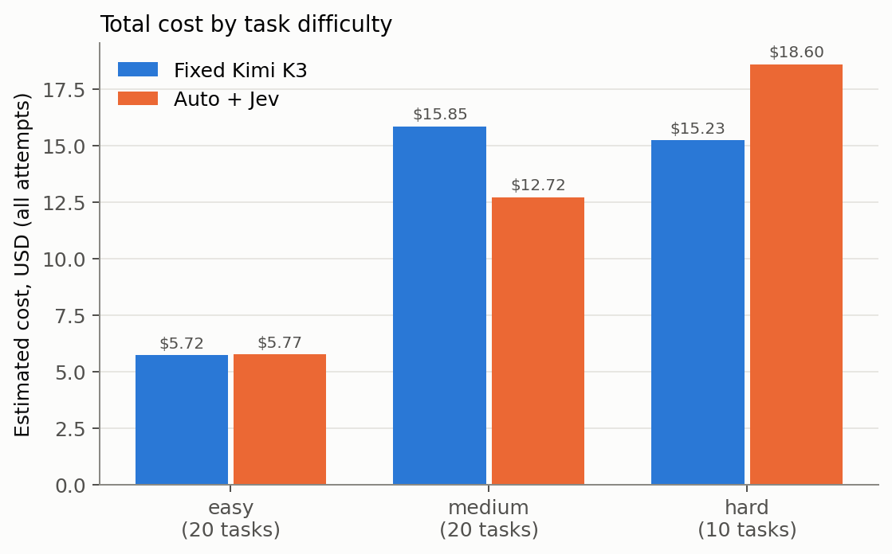
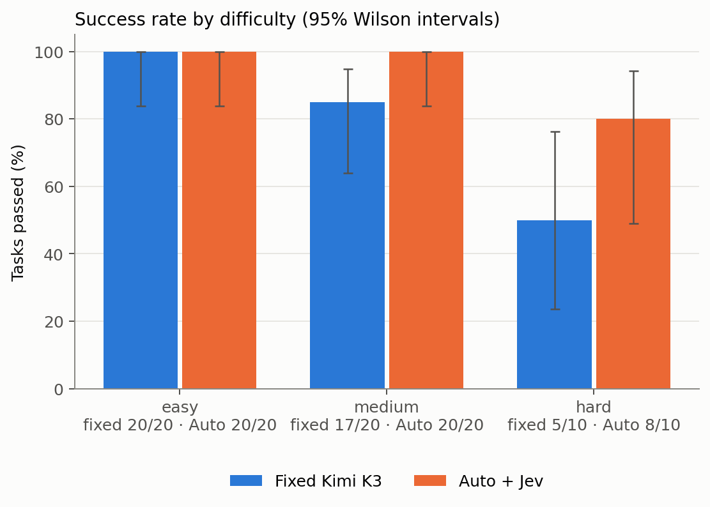
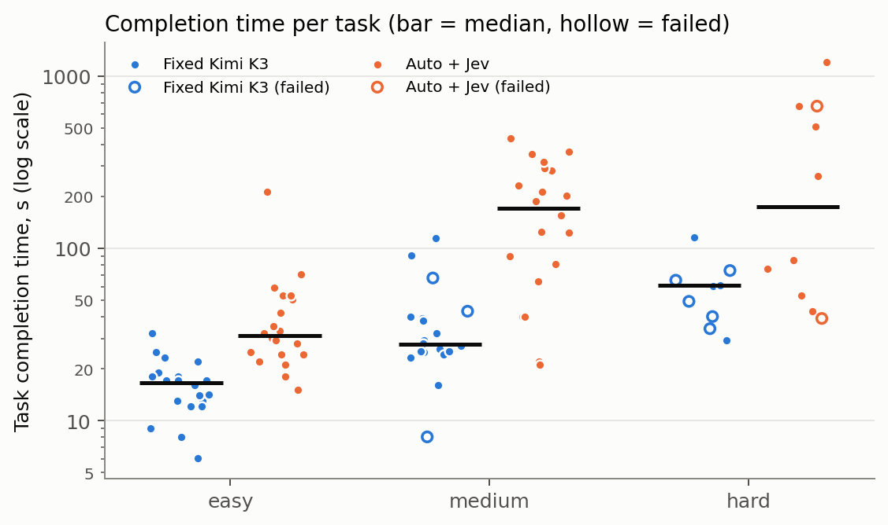
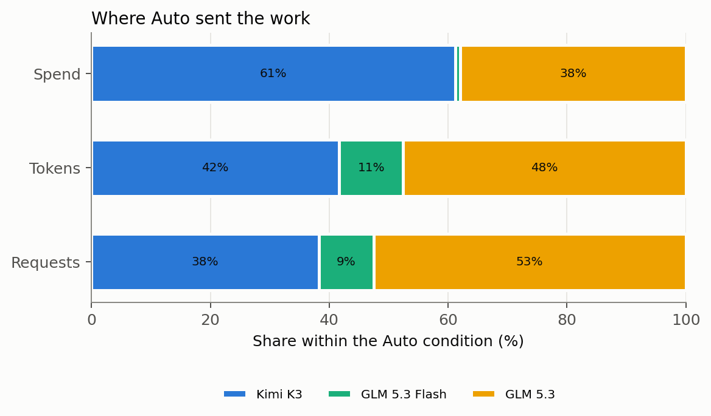
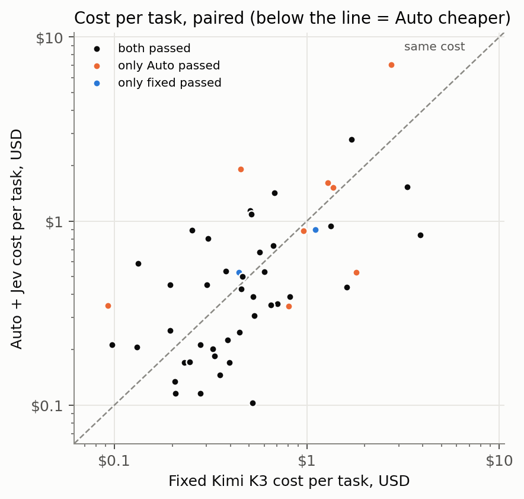

# Results: main

Generated from `runs/main/` by `bench/analyze.py` and `bench/report.py`. Every number below can be traced to
`results.jsonl` and the raw files of the execution named in the per-task table.

- Executions: 100 (task executions; each makes many model API requests, counted separately below).
- nconnect v0.23.0 (bundle `db122e275473…`, source `66bf93f`), 2.1.299 (Claude Code), Node v24.18.1, Python 3.11.5.
- Prices: Nebius catalog captured 2026-10-14T16:49:13.418Z; Jev jev-1.13.0 at $0.042/M input tokens.
- Costs are **estimates** from provider-reported tokens and those prices, not reconciled against Nebius billing. Cached input
  is charged at the full input rate (Nebius publishes no cached price); the cache-free lower bound is shown alongside.
- Run events: prepared; run started; infrastructure failure: excluded and queued for re-run; run started; provider unhealthy; waiting; run started; provider unhealthy; waiting; kept interrupted attempt; provider unhealthy; waiting; provider unhealthy; waiting; run complete; infrastructure failure: excluded and queued for re-run; infrastructure failure: excluded and queued for re-run; infrastructure failure: excluded and queued for re-run; infrastructure failure: excluded and queued for re-run; infrastructure failure: excluded and queued for re-run; infrastructure failure: excluded and queued for re-run; infrastructure failure: excluded and queued for re-run; infrastructure failure: excluded and queued for re-run; infrastructure failure: excluded and queued for re-run; run started; run complete.

## Headline (paired tasks)

- Paired tasks: **50**.
- Quality: Auto minus fixed = **+12.0 percentage points** [+0.0, +24.0] (bootstrap 95% CI). Exact McNemar p = 0.109 on 10 discordant pairs.
- Cost: fixed $36.79, Auto $37.09. Savings **-0.8%** [-36.9%, 28.9%], i.e. a cost-reduction factor of **0.99×** ($-0.2949 saved). Auto was cheaper on 28 of 50 tasks.
- Time: total fixed 27.8 min, Auto 135.6 min; speedup by total time **0.20×**, by median 0.41×, geometric mean over the 40 tasks both passed 0.35× [0.27×, 0.44×]. Auto was faster on 3 of those 40.
- Speedup above 1× means Auto finished faster; below 1× means slower.

## Excluded executions (Amendments 1 and 2)

Executions excluded as provider outages (Amendment 1) or host sleep (Amendment 2), and re-run. Evidence is kept:

| Task | Condition | Execution | Cost | Duration | Reason | Evidence |
|---|---|---|---|---|---|---|
| ts-todo-query | B | 008 | $0.0138 | 20.0 min | infrastructure failure: the last 3 model requests (zai-org/GLM-5.3) got no provider response; 22 of 23 model requests failed | `attempts/008-r1-ts-todo-query-B.infra-1` |
| py-top-n-reverse | B | 088 | $0.1471 | 84 s | infrastructure failure: the host machine was asleep for 46 s of its 84 s | `attempts/088-r1-py-top-n-reverse-B.infra-1` |
| py-inventory-reservations | A | 089 | $0.9867 | 2.3 min | infrastructure failure: the host machine was asleep for 94 s of its 140 s | `attempts/089-r1-py-inventory-reservations-A.infra-1` |
| py-inventory-reservations | B | 090 | $1.05 | 3.5 min | infrastructure failure: the host machine was asleep for 165 s of its 208 s | `attempts/090-r1-py-inventory-reservations-B.infra-1` |
| ts-format-money | A | 092 | $0.3795 | 3.9 min | infrastructure failure: the host machine was asleep for 215 s of its 235 s | `attempts/092-r1-ts-format-money-A.infra-1` |
| py-report-csv-export | B | 094 | $0.5669 | 5.4 min | infrastructure failure: the host machine was asleep for 260 s of its 325 s | `attempts/094-r1-py-report-csv-export-B.infra-1` |
| ts-undo-redo | A | 095 | $0.4588 | 61.8 min | infrastructure failure: the host machine was asleep for 3687 s of its 3708 s | `attempts/095-r1-ts-undo-redo-A.infra-1` |
| ts-undo-redo | B | 096 | $0.6916 | 19.5 min | infrastructure failure: the host machine was asleep for 1117 s of its 1171 s | `attempts/096-r1-ts-undo-redo-B.infra-1` |
| js-cli-json-flag | B | 097 | $0.7953 | 16.4 min | infrastructure failure: the host machine was asleep for 938 s of its 982 s | `attempts/097-r1-js-cli-json-flag-B.infra-1` |
| js-cli-json-flag | A | 098 | $0.1853 | 33.0 min | infrastructure failure: the host machine was asleep for 1971 s of its 1980 s | `attempts/098-r1-js-cli-json-flag-A.infra-1` |

Sensitivity, using each excluded attempt as the result instead of its re-run: quality difference +8.0 pp, cost savings 4.3%, speedup by total time 0.66×.

## Scorecard

| Metric | A: fixed Kimi K3 | B: Auto + Jev |
|---|---|---|
| Tasks passed | 42/50 | 48/50 |
| Success rate (95% CI) | 84.0% [71.5%, 91.7%] | 96.0% [86.5%, 98.9%] |
| Total execution cost, estimated (incl. failed tasks) | $36.79 | $37.09 |
|   of which foreground inference | $36.79 | $37.09 |
|   of which background calls | $0.0000 | $0.0000 |
|   of which Jev routing | $0.0000 | $0.0026 |
|   of which unmetered (estimated from bytes) | $0.0000 | $0.0000 |
|   spent on failed tasks | $9.51 | $1.42 |
| Lower bound if cached input were free | $5.64 | $8.35 |
| Average cost per attempted task | $0.7359 | $0.7418 |
| Cost per successful task | $0.8760 | $0.7727 |
| Successful tasks per dollar | 1.1 | 1.3 |
| Successful tasks per hour (one at a time) | 90.7 | 21.2 |
| Median completion time | 25 s | 62 s |
| p95 completion time | 84 s | 10.0 min |
| Median time to first output | 1.9 s | 2.6 s |
| Total wall time | 27.8 min | 135.6 min |
| Input tokens (cached share) | 10,909,039 (95%) | 15,730,297 (91%) |
| Output tokens (reasoning reported) | 271,063 (0) | 1,144,565 (843,442) |
| Tokens per task / per success | 223,602 / 266,193 | 337,497 / 351,560 |
| Model requests per task | 13.4 | 15.8 |
| Tool calls per task | 15.3 | 18.1 |
| Failed tool calls | 146 | 135 |
| Upstream retries / errors / without usage | 0 / 0 / 0 | 0 / 0 / 0 |
| Sessions stopped by a limit | none | wall_limit: 1 |
| Auto escalations (tasks with stuck → strong) | n/a | 12 (96 stuck routes) |
| Anomalies / contamination flags | 0 / 0 | 0 / 0 |

## Paired outcomes

| Tasks | Both pass | Only fixed passes | Only Auto passes | Both fail | McNemar p |
|---|---|---|---|---|---|
| all | 40 | 2 | 8 | 0 | 0.109 |
| easy | 20 | 0 | 0 | 0 | 1.000 |
| medium | 17 | 0 | 3 | 0 | 0.250 |
| hard | 3 | 2 | 5 | 0 | 0.453 |

## By difficulty

| Difficulty | Tasks | Passed A / B | Cost A / B | Savings | Cost per success A / B | Median time A / B |
|---|---|---|---|---|---|---|
| easy | 20 | 20 / 20 | $5.72 / $5.77 | -1% | $0.2858 / $0.2883 | 17 s / 31 s |
| medium | 20 | 17 / 20 | $15.85 / $12.72 | 20% | $0.9324 / $0.6361 | 28 s / 2.9 min |
| hard | 10 | 5 / 8 | $15.23 / $18.60 | -22% | $3.05 / $2.33 | 61 s / 2.9 min |

## By category

| Category | Tasks | Passed A / B | Cost A / B | Savings | Cost per success A / B | Median time A / B |
|---|---|---|---|---|---|---|
| api-change | 5 | 4 / 5 | $3.19 / $2.51 | 21% | $0.7971 / $0.5014 | 24 s / 2.6 min |
| bugfix | 7 | 6 / 7 | $3.44 / $3.61 | -5% | $0.5737 / $0.5159 | 23 s / 24 s |
| feature | 5 | 3 / 5 | $3.44 / $5.59 | -62% | $1.15 / $1.12 | 25 s / 85 s |
| formatting | 6 | 6 / 6 | $5.12 / $2.73 | 47% | $0.8526 / $0.4554 | 21 s / 57 s |
| parsing | 6 | 6 / 6 | $5.01 / $4.83 | 3% | $0.8349 / $0.8058 | 39 s / 2.6 min |
| refactor | 4 | 3 / 4 | $2.30 / $3.54 | -54% | $0.7663 / $0.8856 | 29 s / 65 s |
| state | 5 | 3 / 5 | $5.51 / $9.28 | -69% | $1.84 / $1.86 | 27 s / 5.3 min |
| utility | 6 | 5 / 5 | $2.43 / $2.18 | 10% | $0.4866 / $0.4362 | 21 s / 47 s |
| validation | 6 | 6 / 5 | $6.35 / $2.80 | 56% | $1.06 / $0.5604 | 21 s / 46 s |

## Where the work and the money went

| Condition | Model | Requests (share) | Tokens (share) | Spend (share) |
|---|---|---|---|---|
| A | moonshotai/Kimi-K3 | 668 (100%) | 11,180,102 (100%) | $36.79 (100%) |
| B | moonshotai/Kimi-K3 | 303 (38%) | 7,033,582 (42%) | $22.72 (61%) |
| B | zai-org/GLM-5.3 | 416 (53%) | 8,030,839 (48%) | $14.07 (38%) |
| B | zai-org/GLM-5.3-Flash | 73 (9%) | 1,810,441 (11%) | $0.2950 (1%) |

## Auto's routing

First tier Auto chose for each task, by the evaluator's difficulty label (a diagnostic, not a quality measure):

| Difficulty | fast | balanced | strong | none |
|---|---|---|---|---|
| easy | 0 | 20 | 0 | 0 |
| medium | 0 | 17 | 3 | 0 |
| hard | 0 | 4 | 6 | 0 |

Jev's own choice on the task prompt:

| Difficulty | routine | moderate | hard | none |
|---|---|---|---|---|
| easy | 0 | 20 | 0 | 0 |
| medium | 0 | 18 | 2 | 0 |
| hard | 0 | 4 | 6 | 0 |

- Model requests by tier: {"strong": 303, "balanced": 416, "fast": 73}; by reason: {"decider_hard": 207, "decider_moderate": 416, "decider_routine": 73, "stuck": 96}.
- Tasks that escalated: 12; tasks that reached the strong tier at some point: 21.
- Tasks that moved down a tier mid-task: 5; tasks where Jev was asked more than once: 10; tasks where Claude Code resumed after hitting the output-token limit: 10. (nconnect treats Claude Code's "Output token limit hit" message as a new prompt, asks Jev about it, and re-routes the rest of the task.)
- Jev calls: 115 (task decisions plus one warm-up per session), cost $0.0026; decision latency median 334 ms, p95 451 ms.
- Jev gave no answer (keyword rules used instead): 0 of 115 decider events; answers that arrived after the 2.5 s wait: 0.
- Jev versions that answered: {"jev-1.13.0": 50}.
- Reasoning effort sent upstream (all requests): {"medium": 6, "none": 294, "None": 416, "low": 73, "high": 3}.

## Scenarios

Each list includes every task that meets its rule.

### Routine work where routing saved money with a correct result

Rule: Auto's first tier was fast, both conditions passed, Auto cost less. Sorted by savings. Matches: 0.

### Routing saved money with a correct result (any tier)

Rule: Both conditions passed and Auto cost less. Sorted by savings. Matches: 24.

| Task | Difficulty | Auto tiers | Fixed / Auto | Cost fixed / Auto | Time fixed / Auto | Calls fixed / Auto | Executions |
|---|---|---|---|---|---|---|---|
| py-chunk-evenly | easy | balanced | pass / pass | $0.5230 / $0.1025 | 25 s / 15 s | 14 / 6 | 051, 052 |
| ts-signup-validate | medium | balanced | pass / pass | $3.89 / $0.8396 | 115 s / 4.9 min | 45 / 14 | 014, 013 |
| ts-semver-range | medium | balanced → fast | pass / pass | $1.61 / $0.4377 | 91 s / 5.8 min | 20 / 27 | 017, 018 |
| ts-hex-color | easy | balanced | pass / pass | $0.3540 / $0.1460 | 16 s / 29 s | 10 / 8 | 077, 078 |
| py-format-phone | easy | balanced | pass / pass | $0.2789 / $0.1159 | 18 s / 21 s | 8 / 6 | 039, 040 |
| ts-notify-many | easy | balanced | pass / pass | $0.3946 / $0.1699 | 22 s / 50 s | 10 / 9 | 064, 063 |
| ts-table-wrap | hard | balanced → fast → strong | pass / pass | $3.32 / $1.53 | 116 s / 11.2 min | 39 / 33 | 086, 085 |
| py-report-csv-export | medium | balanced | pass / pass | $0.8134 / $0.3879 | 25 s / 40 s | 16 / 14 | 093, 094 |
| js-client-options | medium | balanced | pass / pass | $0.7019 / $0.3550 | 28 s / 2.6 min | 15 / 9 | 056, 055 |
| py-weekly-report-bugs | medium | strong | pass / pass | $0.6518 / $0.3507 | 32 s / 22 s | 15 / 9 | 026, 025 |
| py-user-stats-dataclass | medium | balanced | pass / pass | $0.4467 / $0.2481 | 24 s / 3.1 min | 10 / 12 | 083, 084 |
| ts-format-money | easy | balanced | pass / pass | $0.3322 / $0.1847 | 17 s / 24 s | 10 / 10 | 092, 091 |
| js-score-sort | easy | balanced | pass / pass | $0.2079 / $0.1157 | 13 s / 18 s | 6 / 7 | 015, 016 |
| js-human-duration | medium | balanced | pass / pass | $0.5313 / $0.3053 | 29 s / 81 s | 12 / 7 | 047, 048 |
| py-shared-default-tags | easy | balanced | pass / pass | $0.3880 / $0.2255 | 23 s / 42 s | 10 / 11 | 081, 082 |
| py-parse-kv | easy | balanced | pass / pass | $0.3253 / $0.2019 | 17 s / 30 s | 9 / 11 | 072, 071 |
| py-validate-username | easy | balanced | pass / pass | $0.2056 / $0.1344 | 12 s / 25 s | 6 / 6 | 042, 041 |
| ts-parse-clock | easy | balanced | pass / pass | $0.2456 / $0.1720 | 14 s / 32 s | 7 / 8 | 045, 046 |
| py-inventory-reservations | hard | strong | pass / pass | $1.33 / $0.9379 | 61 s / 53 s | 23 / 17 | 089, 090 |
| ts-clamp-range | easy | balanced | pass / pass | $0.2306 / $0.1699 | 12 s / 22 s | 7 / 10 | 060, 059 |
| py-flatten-records-csv | medium | balanced | pass / pass | $0.5235 / $0.3883 | 24 s / 90 s | 13 / 13 | 004, 003 |
| py-top-n-reverse | easy | balanced | pass / pass | $0.2801 / $0.2126 | 14 s / 28 s | 8 / 10 | 087, 088 |
| py-card-iban | medium | balanced → strong | pass / pass | $0.6005 / $0.5313 | 26 s / 2.1 min | 14 / 13 | 029, 030 |
| ts-weighted-lru | medium | balanced | pass / pass | $0.4554 / $0.4282 | 23 s / 3.4 min | 11 / 13 | 076, 075 |

### Work where Auto chose or escalated to the strong model

Rule: Auto's first tier was strong, or it escalated during the task. Matches: 21.

| Task | Difficulty | Auto tiers | Fixed / Auto | Cost fixed / Auto | Time fixed / Auto | Calls fixed / Auto | Executions |
|---|---|---|---|---|---|---|---|
| js-cli-json-flag | easy | balanced → strong | pass / pass | $0.3804 / $0.5347 | 18 s / 35 s | 10 / 17 | 098, 097 |
| js-debounce-bugs | medium | strong | pass / pass | $0.6789 / $1.42 | 40 s / 64 s | 13 / 21 | 002, 001 |
| js-pick-omit | easy | balanced → strong | pass / pass | $0.1324 / $0.5866 | 9.1 s / 53 s | 4 / 17 | 068, 067 |
| js-site-plugins | medium | balanced → strong | pass / pass | $0.5077 / $1.14 | 25 s / 3.6 min | 11 / 19 | 099, 100 |
| py-async-rate-limiter | hard | strong | FAIL / pass | $2.74 / $7.07 | 74 s / 20.0 min | 34 / 63 | 027, 028 |
| py-card-iban | medium | balanced → strong | pass / pass | $0.6005 / $0.5313 | 26 s / 2.1 min | 14 / 13 | 029, 030 |
| py-expr-eval | hard | strong | pass / pass | $1.70 / $2.79 | 61 s / 76 s | 26 / 36 | 033, 034 |
| py-extract-validators | medium | balanced → strong | pass / pass | $0.5150 / $1.09 | 25 s / 2.1 min | 11 / 20 | 049, 050 |
| py-inventory-reservations | hard | strong | pass / pass | $1.33 / $0.9379 | 61 s / 53 s | 23 / 17 | 089, 090 |
| py-memoize | easy | balanced → strong | pass / pass | $0.1953 / $0.4518 | 19 s / 3.6 min | 5 / 13 | 010, 009 |
| py-order-state-machine | medium | balanced → strong | pass / pass | $0.3068 / $0.8056 | 27 s / 5.3 min | 7 / 17 | 080, 079 |
| py-retry-backoff | medium | balanced → strong | pass / pass | $0.3012 / $0.4504 | 16 s / 40 s | 8 / 18 | 057, 058 |
| py-shipping-constants | easy | balanced → strong | pass / pass | $0.5680 / $0.6768 | 32 s / 59 s | 13 / 18 | 053, 054 |
| py-weekly-report-bugs | medium | strong | pass / pass | $0.6518 / $0.3507 | 32 s / 22 s | 15 / 9 | 026, 025 |
| ts-config-promise | easy | balanced → strong | pass / pass | $0.2523 / $0.8913 | 17 s / 70 s | 7 / 24 | 021, 022 |
| ts-emitter-bugs | medium | strong | FAIL / pass | $0.0927 / $0.3483 | 8.1 s / 21 s | 3 / 9 | 066, 065 |
| ts-pricing-rules | hard | strong | FAIL / pass | $0.9636 / $0.8853 | 40 s / 43 s | 17 / 14 | 070, 069 |
| ts-schema-validator | hard | strong | pass / FAIL | $1.11 / $0.8967 | 60 s / 39 s | 19 / 14 | 044, 043 |
| ts-table-wrap | hard | balanced → fast → strong | pass / pass | $3.32 / $1.53 | 116 s / 11.2 min | 39 / 33 | 086, 085 |
| ts-todo-query | medium | balanced → strong | FAIL / pass | $1.29 / $1.61 | 67 s / 4.7 min | 21 / 27 | 007, 008 |
| ts-undo-redo | hard | strong | FAIL / pass | $0.4530 / $1.92 | 34 s / 85 s | 9 / 24 | 095, 096 |

### Routing hurt quality

Rule: Fixed passed and Auto failed. Matches: 2.

| Task | Difficulty | Auto tiers | Fixed / Auto | Cost fixed / Auto | Time fixed / Auto | Calls fixed / Auto | Executions |
|---|---|---|---|---|---|---|---|
| py-cron-next | hard | balanced → fast | pass / FAIL | $0.4439 / $0.5257 | 29 s / 11.2 min | 9 / 20 | 074, 073 |
| ts-schema-validator | hard | strong | pass / FAIL | $1.11 / $0.8967 | 60 s / 39 s | 19 / 14 | 044, 043 |

### Routing helped quality

Rule: Auto passed and fixed failed. Matches: 8.

| Task | Difficulty | Auto tiers | Fixed / Auto | Cost fixed / Auto | Time fixed / Auto | Calls fixed / Auto | Executions |
|---|---|---|---|---|---|---|---|
| py-async-rate-limiter | hard | strong | FAIL / pass | $2.74 / $7.07 | 74 s / 20.0 min | 34 / 63 | 027, 028 |
| py-cursor-pagination | hard | balanced | FAIL / pass | $1.37 / $1.52 | 49 s / 4.4 min | 23 / 30 | 037, 038 |
| ts-deep-merge | medium | balanced → fast | FAIL / pass | $0.8020 / $0.3459 | 43 s / 7.3 min | 17 / 16 | 006, 005 |
| ts-emitter-bugs | medium | strong | FAIL / pass | $0.0927 / $0.3483 | 8.1 s / 21 s | 3 / 9 | 066, 065 |
| ts-pricing-rules | hard | strong | FAIL / pass | $0.9636 / $0.8853 | 40 s / 43 s | 17 / 14 | 070, 069 |
| ts-singleflight-cache | hard | balanced → fast | FAIL / pass | $1.81 / $0.5270 | 65 s / 8.5 min | 28 / 19 | 036, 035 |
| ts-todo-query | medium | balanced → strong | FAIL / pass | $1.29 / $1.61 | 67 s / 4.7 min | 21 / 27 | 007, 008 |
| ts-undo-redo | hard | strong | FAIL / pass | $0.4530 / $1.92 | 34 s / 85 s | 9 / 24 | 095, 096 |

### Routing increased completion time

Rule: Both passed and Auto took at least 1.5× as long. Matches: 33.

| Task | Difficulty | Auto tiers | Fixed / Auto | Cost fixed / Auto | Time fixed / Auto | Calls fixed / Auto | Executions |
|---|---|---|---|---|---|---|---|
| js-cli-json-flag | easy | balanced → strong | pass / pass | $0.3804 / $0.5347 | 18 s / 35 s | 10 / 17 | 098, 097 |
| js-client-options | medium | balanced | pass / pass | $0.7019 / $0.3550 | 28 s / 2.6 min | 15 / 9 | 056, 055 |
| js-debounce-bugs | medium | strong | pass / pass | $0.6789 / $1.42 | 40 s / 64 s | 13 / 21 | 002, 001 |
| js-email-list | easy | balanced | pass / pass | $0.1946 / $0.2543 | 13 s / 53 s | 5 / 7 | 061, 062 |
| js-human-duration | medium | balanced | pass / pass | $0.5313 / $0.3053 | 29 s / 81 s | 12 / 7 | 047, 048 |
| js-parse-ini | medium | balanced | pass / pass | $0.6680 / $0.7365 | 38 s / 3.9 min | 14 / 12 | 024, 023 |
| js-pick-omit | easy | balanced → strong | pass / pass | $0.1324 / $0.5866 | 9.1 s / 53 s | 4 / 17 | 068, 067 |
| js-pluralize | easy | balanced | pass / pass | $0.1312 / $0.2067 | 8.1 s / 33 s | 4 / 10 | 032, 031 |
| js-site-plugins | medium | balanced → strong | pass / pass | $0.5077 / $1.14 | 25 s / 3.6 min | 11 / 19 | 099, 100 |
| py-card-iban | medium | balanced → strong | pass / pass | $0.6005 / $0.5313 | 26 s / 2.1 min | 14 / 13 | 029, 030 |
| py-extract-validators | medium | balanced → strong | pass / pass | $0.5150 / $1.09 | 25 s / 2.1 min | 11 / 20 | 049, 050 |
| py-flatten-records-csv | medium | balanced | pass / pass | $0.5235 / $0.3883 | 24 s / 90 s | 13 / 13 | 004, 003 |
| py-memoize | easy | balanced → strong | pass / pass | $0.1953 / $0.4518 | 19 s / 3.6 min | 5 / 13 | 010, 009 |
| py-order-state-machine | medium | balanced → strong | pass / pass | $0.3068 / $0.8056 | 27 s / 5.3 min | 7 / 17 | 080, 079 |
| py-parse-kv | easy | balanced | pass / pass | $0.3253 / $0.2019 | 17 s / 30 s | 9 / 11 | 072, 071 |
| py-parse-query | medium | balanced | pass / pass | $0.4638 / $0.5013 | 39 s / 6.0 min | 9 / 13 | 011, 012 |
| py-report-csv-export | medium | balanced | pass / pass | $0.8134 / $0.3879 | 25 s / 40 s | 16 / 14 | 093, 094 |
| py-retry-backoff | medium | balanced → strong | pass / pass | $0.3012 / $0.4504 | 16 s / 40 s | 8 / 18 | 057, 058 |
| py-shared-default-tags | easy | balanced | pass / pass | $0.3880 / $0.2255 | 23 s / 42 s | 10 / 11 | 081, 082 |
| py-shipping-constants | easy | balanced → strong | pass / pass | $0.5680 / $0.6768 | 32 s / 59 s | 13 / 18 | 053, 054 |
| py-top-n-reverse | easy | balanced | pass / pass | $0.2801 / $0.2126 | 14 s / 28 s | 8 / 10 | 087, 088 |
| py-user-stats-dataclass | medium | balanced | pass / pass | $0.4467 / $0.2481 | 24 s / 3.1 min | 10 / 12 | 083, 084 |
| py-validate-username | easy | balanced | pass / pass | $0.2056 / $0.1344 | 12 s / 25 s | 6 / 6 | 042, 041 |
| ts-clamp-range | easy | balanced | pass / pass | $0.2306 / $0.1699 | 12 s / 22 s | 7 / 10 | 060, 059 |
| ts-config-promise | easy | balanced → strong | pass / pass | $0.2523 / $0.8913 | 17 s / 70 s | 7 / 24 | 021, 022 |
| ts-hex-color | easy | balanced | pass / pass | $0.3540 / $0.1460 | 16 s / 29 s | 10 / 8 | 077, 078 |
| ts-notify-many | easy | balanced | pass / pass | $0.3946 / $0.1699 | 22 s / 50 s | 10 / 9 | 064, 063 |
| ts-paginate-off-by-one | easy | balanced | pass / pass | $0.0969 / $0.2126 | 6.0 s / 24 s | 3 / 11 | 020, 019 |
| ts-parse-clock | easy | balanced | pass / pass | $0.2456 / $0.1720 | 14 s / 32 s | 7 / 8 | 045, 046 |
| ts-semver-range | medium | balanced → fast | pass / pass | $1.61 / $0.4377 | 91 s / 5.8 min | 20 / 27 | 017, 018 |
| ts-signup-validate | medium | balanced | pass / pass | $3.89 / $0.8396 | 115 s / 4.9 min | 45 / 14 | 014, 013 |
| ts-table-wrap | hard | balanced → fast → strong | pass / pass | $3.32 / $1.53 | 116 s / 11.2 min | 39 / 33 | 086, 085 |
| ts-weighted-lru | medium | balanced | pass / pass | $0.4554 / $0.4282 | 23 s / 3.4 min | 11 / 13 | 076, 075 |

### The fixed model was the better choice on cost too

Rule: Both passed and Auto cost more than fixed Kimi K3. Matches: 16.

| Task | Difficulty | Auto tiers | Fixed / Auto | Cost fixed / Auto | Time fixed / Auto | Calls fixed / Auto | Executions |
|---|---|---|---|---|---|---|---|
| js-cli-json-flag | easy | balanced → strong | pass / pass | $0.3804 / $0.5347 | 18 s / 35 s | 10 / 17 | 098, 097 |
| js-debounce-bugs | medium | strong | pass / pass | $0.6789 / $1.42 | 40 s / 64 s | 13 / 21 | 002, 001 |
| js-email-list | easy | balanced | pass / pass | $0.1946 / $0.2543 | 13 s / 53 s | 5 / 7 | 061, 062 |
| js-parse-ini | medium | balanced | pass / pass | $0.6680 / $0.7365 | 38 s / 3.9 min | 14 / 12 | 024, 023 |
| js-pick-omit | easy | balanced → strong | pass / pass | $0.1324 / $0.5866 | 9.1 s / 53 s | 4 / 17 | 068, 067 |
| js-pluralize | easy | balanced | pass / pass | $0.1312 / $0.2067 | 8.1 s / 33 s | 4 / 10 | 032, 031 |
| js-site-plugins | medium | balanced → strong | pass / pass | $0.5077 / $1.14 | 25 s / 3.6 min | 11 / 19 | 099, 100 |
| py-expr-eval | hard | strong | pass / pass | $1.70 / $2.79 | 61 s / 76 s | 26 / 36 | 033, 034 |
| py-extract-validators | medium | balanced → strong | pass / pass | $0.5150 / $1.09 | 25 s / 2.1 min | 11 / 20 | 049, 050 |
| py-memoize | easy | balanced → strong | pass / pass | $0.1953 / $0.4518 | 19 s / 3.6 min | 5 / 13 | 010, 009 |
| py-order-state-machine | medium | balanced → strong | pass / pass | $0.3068 / $0.8056 | 27 s / 5.3 min | 7 / 17 | 080, 079 |
| py-parse-query | medium | balanced | pass / pass | $0.4638 / $0.5013 | 39 s / 6.0 min | 9 / 13 | 011, 012 |
| py-retry-backoff | medium | balanced → strong | pass / pass | $0.3012 / $0.4504 | 16 s / 40 s | 8 / 18 | 057, 058 |
| py-shipping-constants | easy | balanced → strong | pass / pass | $0.5680 / $0.6768 | 32 s / 59 s | 13 / 18 | 053, 054 |
| ts-config-promise | easy | balanced → strong | pass / pass | $0.2523 / $0.8913 | 17 s / 70 s | 7 / 24 | 021, 022 |
| ts-paginate-off-by-one | easy | balanced | pass / pass | $0.0969 / $0.2126 | 6.0 s / 24 s | 3 / 11 | 020, 019 |

### Cheaper per token, not cheaper per task

Rule: Auto made at least 1.5× as many model calls as fixed (longer sessions on cheaper models). Matches: 15.

| Task | Difficulty | Auto tiers | Fixed / Auto | Cost fixed / Auto | Time fixed / Auto | Calls fixed / Auto | Executions |
|---|---|---|---|---|---|---|---|
| js-cli-json-flag | easy | balanced → strong | pass / pass | $0.3804 / $0.5347 | 18 s / 35 s | 10 / 17 | 098, 097 |
| js-debounce-bugs | medium | strong | pass / pass | $0.6789 / $1.42 | 40 s / 64 s | 13 / 21 | 002, 001 |
| js-pick-omit | easy | balanced → strong | pass / pass | $0.1324 / $0.5866 | 9.1 s / 53 s | 4 / 17 | 068, 067 |
| js-pluralize | easy | balanced | pass / pass | $0.1312 / $0.2067 | 8.1 s / 33 s | 4 / 10 | 032, 031 |
| js-site-plugins | medium | balanced → strong | pass / pass | $0.5077 / $1.14 | 25 s / 3.6 min | 11 / 19 | 099, 100 |
| py-async-rate-limiter | hard | strong | FAIL / pass | $2.74 / $7.07 | 74 s / 20.0 min | 34 / 63 | 027, 028 |
| py-cron-next | hard | balanced → fast | pass / FAIL | $0.4439 / $0.5257 | 29 s / 11.2 min | 9 / 20 | 074, 073 |
| py-extract-validators | medium | balanced → strong | pass / pass | $0.5150 / $1.09 | 25 s / 2.1 min | 11 / 20 | 049, 050 |
| py-memoize | easy | balanced → strong | pass / pass | $0.1953 / $0.4518 | 19 s / 3.6 min | 5 / 13 | 010, 009 |
| py-order-state-machine | medium | balanced → strong | pass / pass | $0.3068 / $0.8056 | 27 s / 5.3 min | 7 / 17 | 080, 079 |
| py-retry-backoff | medium | balanced → strong | pass / pass | $0.3012 / $0.4504 | 16 s / 40 s | 8 / 18 | 057, 058 |
| ts-config-promise | easy | balanced → strong | pass / pass | $0.2523 / $0.8913 | 17 s / 70 s | 7 / 24 | 021, 022 |
| ts-emitter-bugs | medium | strong | FAIL / pass | $0.0927 / $0.3483 | 8.1 s / 21 s | 3 / 9 | 066, 065 |
| ts-paginate-off-by-one | easy | balanced | pass / pass | $0.0969 / $0.2126 | 6.0 s / 24 s | 3 / 11 | 020, 019 |
| ts-undo-redo | hard | strong | FAIL / pass | $0.4530 / $1.92 | 34 s / 85 s | 9 / 24 | 095, 096 |

## Per task

| Task | Difficulty | Fixed model(s) | Auto model(s) / tiers | Fixed | Auto | Fixed cost | Auto cost | Savings | Fixed time | Auto time | Notable |
|---|---|---|---|---|---|---|---|---|---|---|---|
| js-cli-json-flag | easy | Kimi K3×10 | GLM 5.3×11 + Kimi K3×6 (balanced → strong) | pass | pass | $0.3804 | $0.5347 | -40.6% | 18 s | 35 s | Auto escalated 1×; stuck → strong; Auto cost more; Auto took 17 model calls vs 10 |
| js-client-options | medium | Kimi K3×15 | GLM 5.3×9 (balanced) | pass | pass | $0.7019 | $0.3550 | 49.4% | 28 s | 2.6 min |  |
| js-debounce-bugs | medium | Kimi K3×13 | Kimi K3×21 (strong) | pass | pass | $0.6789 | $1.42 | -109.3% | 40 s | 64 s | Auto cost more; Auto took 21 model calls vs 13 |
| js-email-list | easy | Kimi K3×5 | GLM 5.3×7 (balanced) | pass | pass | $0.1946 | $0.2543 | -30.6% | 13 s | 53 s | Auto cost more |
| js-human-duration | medium | Kimi K3×12 | GLM 5.3×7 (balanced) | pass | pass | $0.5313 | $0.3053 | 42.5% | 29 s | 81 s |  |
| js-parse-ini | medium | Kimi K3×14 | GLM 5.3×12 (balanced) | pass | pass | $0.6680 | $0.7365 | -10.3% | 38 s | 3.9 min | Auto cost more |
| js-pick-omit | easy | Kimi K3×4 | GLM 5.3×9 + Kimi K3×8 (balanced → strong) | pass | pass | $0.1324 | $0.5866 | -343.0% | 9.1 s | 53 s | Auto escalated 1×; stuck → strong; Auto cost more; Auto took 17 model calls vs 4 |
| js-pluralize | easy | Kimi K3×4 | GLM 5.3×10 (balanced) | pass | pass | $0.1312 | $0.2067 | -57.5% | 8.1 s | 33 s | Auto cost more; Auto took 10 model calls vs 4 |
| js-score-sort | easy | Kimi K3×6 | GLM 5.3×7 (balanced) | pass | pass | $0.2079 | $0.1157 | 44.3% | 13 s | 18 s |  |
| js-site-plugins | medium | Kimi K3×11 | GLM 5.3×13 + Kimi K3×6 (balanced → strong) | pass | pass | $0.5077 | $1.14 | -124.8% | 25 s | 3.6 min | Auto escalated 1×; stuck → strong; Auto cost more; Auto took 19 model calls vs 11 |
| py-async-rate-limiter | hard | Kimi K3×34 | Kimi K3×63 (strong) | FAIL | pass | $2.74 | $7.07 | -158.2% | 74 s | 20.0 min | only Auto passed; Auto hit wall_limit; Auto cost more |
| py-card-iban | medium | Kimi K3×14 | GLM 5.3×9 + Kimi K3×4 (balanced → strong) | pass | pass | $0.6005 | $0.5313 | 11.5% | 26 s | 2.1 min | Auto escalated 1×; stuck → strong |
| py-chunk-evenly | easy | Kimi K3×14 | GLM 5.3×6 (balanced) | pass | pass | $0.5230 | $0.1025 | 80.4% | 25 s | 15 s |  |
| py-cron-next | hard | Kimi K3×9 | GLM 5.3 Flash×13 + GLM 5.3×7 (balanced → fast) | pass | FAIL | $0.4439 | $0.5257 | -18.4% | 29 s | 11.2 min | only fixed passed; Auto cost more |
| py-cursor-pagination | hard | Kimi K3×23 | GLM 5.3×30 (balanced) | FAIL | pass | $1.37 | $1.52 | -11.4% | 49 s | 4.4 min | only Auto passed; Auto cost more |
| py-expr-eval | hard | Kimi K3×26 | Kimi K3×36 (strong) | pass | pass | $1.70 | $2.79 | -63.8% | 61 s | 76 s | Auto cost more |
| py-extract-validators | medium | Kimi K3×11 | Kimi K3×11 + GLM 5.3×9 (balanced → strong) | pass | pass | $0.5150 | $1.09 | -111.4% | 25 s | 2.1 min | Auto escalated 1×; stuck → strong; Auto cost more; Auto took 20 model calls vs 11 |
| py-flatten-records-csv | medium | Kimi K3×13 | GLM 5.3×13 (balanced) | pass | pass | $0.5235 | $0.3883 | 25.8% | 24 s | 90 s |  |
| py-format-phone | easy | Kimi K3×8 | GLM 5.3×6 (balanced) | pass | pass | $0.2789 | $0.1159 | 58.4% | 18 s | 21 s |  |
| py-inventory-reservations | hard | Kimi K3×23 | Kimi K3×17 (strong) | pass | pass | $1.33 | $0.9379 | 29.3% | 61 s | 53 s |  |
| py-memoize | easy | Kimi K3×5 | GLM 5.3×8 + Kimi K3×5 (balanced → strong) | pass | pass | $0.1953 | $0.4518 | -131.3% | 19 s | 3.6 min | Auto escalated 1×; stuck → strong; Auto cost more; Auto took 13 model calls vs 5 |
| py-order-state-machine | medium | Kimi K3×7 | GLM 5.3×14 + Kimi K3×3 (balanced → strong) | pass | pass | $0.3068 | $0.8056 | -162.6% | 27 s | 5.3 min | Auto escalated 1×; stuck → strong; Auto cost more; Auto took 17 model calls vs 7 |
| py-parse-kv | easy | Kimi K3×9 | GLM 5.3×11 (balanced) | pass | pass | $0.3253 | $0.2019 | 37.9% | 17 s | 30 s |  |
| py-parse-query | medium | Kimi K3×9 | GLM 5.3×13 (balanced) | pass | pass | $0.4638 | $0.5013 | -8.1% | 39 s | 6.0 min | Auto cost more |
| py-report-csv-export | medium | Kimi K3×16 | GLM 5.3×14 (balanced) | pass | pass | $0.8134 | $0.3879 | 52.3% | 25 s | 40 s |  |
| py-retry-backoff | medium | Kimi K3×8 | GLM 5.3×17 + Kimi K3×1 (balanced → strong) | pass | pass | $0.3012 | $0.4504 | -49.5% | 16 s | 40 s | Auto escalated 1×; stuck → strong; Auto cost more; Auto took 18 model calls vs 8 |
| py-shared-default-tags | easy | Kimi K3×10 | GLM 5.3×11 (balanced) | pass | pass | $0.3880 | $0.2255 | 41.9% | 23 s | 42 s |  |
| py-shipping-constants | easy | Kimi K3×13 | GLM 5.3×10 + Kimi K3×8 (balanced → strong) | pass | pass | $0.5680 | $0.6768 | -19.2% | 32 s | 59 s | Auto escalated 1×; stuck → strong; Auto cost more |
| py-top-n-reverse | easy | Kimi K3×8 | GLM 5.3×10 (balanced) | pass | pass | $0.2801 | $0.2126 | 24.1% | 14 s | 28 s |  |
| py-user-stats-dataclass | medium | Kimi K3×10 | GLM 5.3×12 (balanced) | pass | pass | $0.4467 | $0.2481 | 44.5% | 24 s | 3.1 min |  |
| py-validate-username | easy | Kimi K3×6 | GLM 5.3×6 (balanced) | pass | pass | $0.2056 | $0.1344 | 34.7% | 12 s | 25 s |  |
| py-weekly-report-bugs | medium | Kimi K3×15 | Kimi K3×9 (strong) | pass | pass | $0.6518 | $0.3507 | 46.2% | 32 s | 22 s |  |
| ts-clamp-range | easy | Kimi K3×7 | GLM 5.3×10 (balanced) | pass | pass | $0.2306 | $0.1699 | 26.3% | 12 s | 22 s |  |
| ts-config-promise | easy | Kimi K3×7 | GLM 5.3×14 + Kimi K3×10 (balanced → strong) | pass | pass | $0.2523 | $0.8913 | -253.3% | 17 s | 70 s | Auto escalated 1×; stuck → strong; Auto cost more; Auto took 24 model calls vs 7 |
| ts-deep-merge | medium | Kimi K3×17 | GLM 5.3 Flash×11 + GLM 5.3×5 (balanced → fast) | FAIL | pass | $0.8020 | $0.3459 | 56.9% | 43 s | 7.3 min | only Auto passed |
| ts-emitter-bugs | medium | Kimi K3×3 | Kimi K3×9 (strong) | FAIL | pass | $0.0927 | $0.3483 | -275.8% | 8.1 s | 21 s | only Auto passed; Auto cost more |
| ts-format-money | easy | Kimi K3×10 | GLM 5.3×10 (balanced) | pass | pass | $0.3322 | $0.1847 | 44.4% | 17 s | 24 s |  |
| ts-hex-color | easy | Kimi K3×10 | GLM 5.3×8 (balanced) | pass | pass | $0.3540 | $0.1460 | 58.8% | 16 s | 29 s |  |
| ts-notify-many | easy | Kimi K3×10 | GLM 5.3×9 (balanced) | pass | pass | $0.3946 | $0.1699 | 57.0% | 22 s | 50 s |  |
| ts-paginate-off-by-one | easy | Kimi K3×3 | GLM 5.3×11 (balanced) | pass | pass | $0.0969 | $0.2126 | -119.4% | 6.0 s | 24 s | Auto cost more; Auto took 11 model calls vs 3 |
| ts-parse-clock | easy | Kimi K3×7 | GLM 5.3×8 (balanced) | pass | pass | $0.2456 | $0.1720 | 30.0% | 14 s | 32 s |  |
| ts-pricing-rules | hard | Kimi K3×17 | Kimi K3×14 (strong) | FAIL | pass | $0.9636 | $0.8853 | 8.1% | 40 s | 43 s | only Auto passed |
| ts-schema-validator | hard | Kimi K3×19 | Kimi K3×14 (strong) | pass | FAIL | $1.11 | $0.8967 | 18.9% | 60 s | 39 s | only fixed passed |
| ts-semver-range | medium | Kimi K3×20 | GLM 5.3 Flash×21 + GLM 5.3×6 (balanced → fast) | pass | pass | $1.61 | $0.4377 | 72.8% | 91 s | 5.8 min |  |
| ts-signup-validate | medium | Kimi K3×45 | GLM 5.3×14 (balanced) | pass | pass | $3.89 | $0.8396 | 78.4% | 115 s | 4.9 min |  |
| ts-singleflight-cache | hard | Kimi K3×28 | GLM 5.3 Flash×13 + GLM 5.3×6 (balanced → fast) | FAIL | pass | $1.81 | $0.5270 | 70.9% | 65 s | 8.5 min | only Auto passed |
| ts-table-wrap | hard | Kimi K3×39 | GLM 5.3 Flash×15 + Kimi K3×14 + GLM 5.3×4 (balanced → fast → strong) | pass | pass | $3.32 | $1.53 | 53.9% | 116 s | 11.2 min | Auto escalated 1×; stuck → strong |
| ts-todo-query | medium | Kimi K3×21 | Kimi K3×20 + GLM 5.3×7 (balanced → strong) | FAIL | pass | $1.29 | $1.61 | -25.0% | 67 s | 4.7 min | only Auto passed; Auto escalated 1×; stuck → strong; Auto cost more |
| ts-undo-redo | hard | Kimi K3×9 | Kimi K3×24 (strong) | FAIL | pass | $0.4530 | $1.92 | -323.5% | 34 s | 85 s | only Auto passed; Auto cost more |
| ts-weighted-lru | medium | Kimi K3×11 | GLM 5.3×13 (balanced) | pass | pass | $0.4554 | $0.4282 | 6.0% | 23 s | 3.4 min |  |

## Charts

