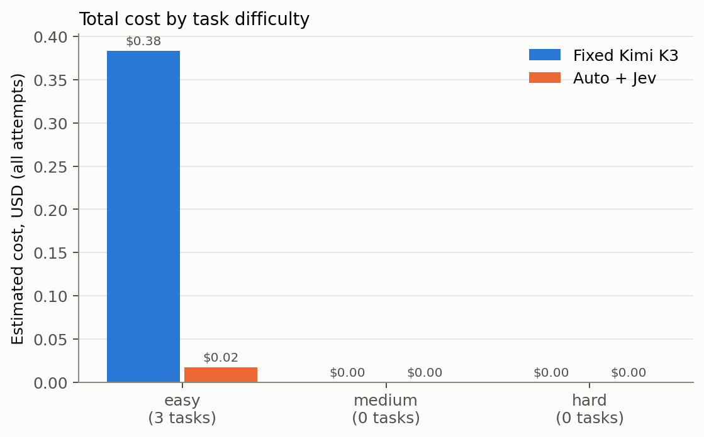
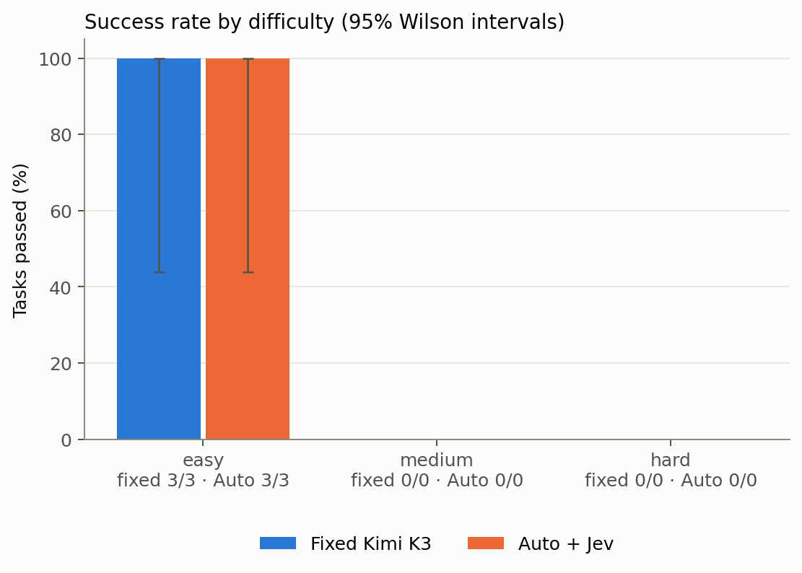
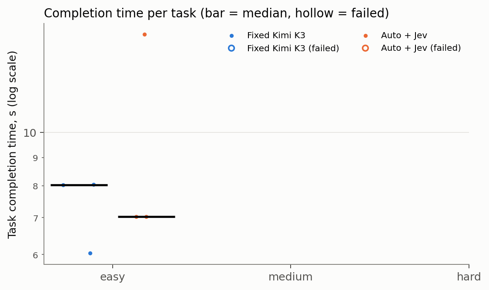
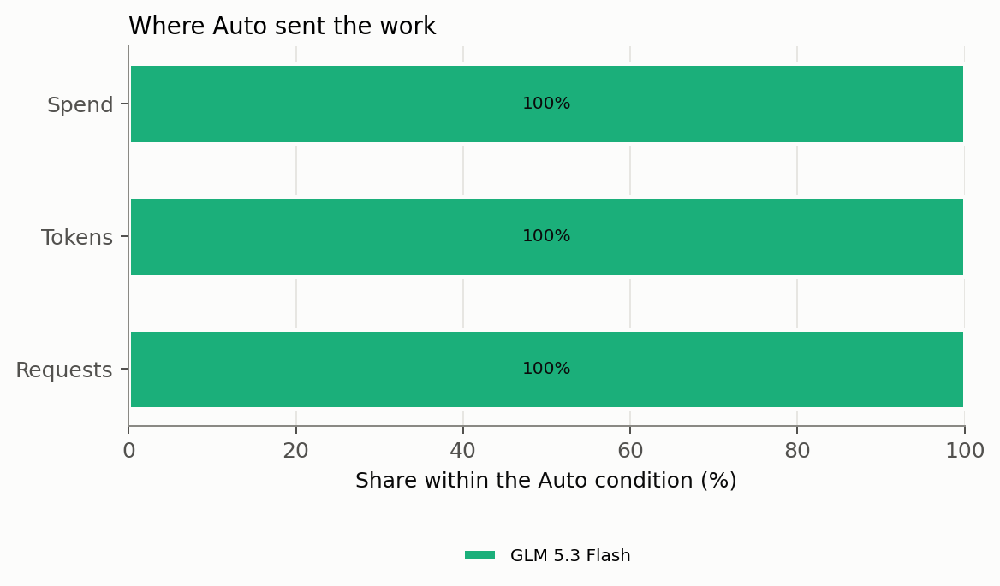
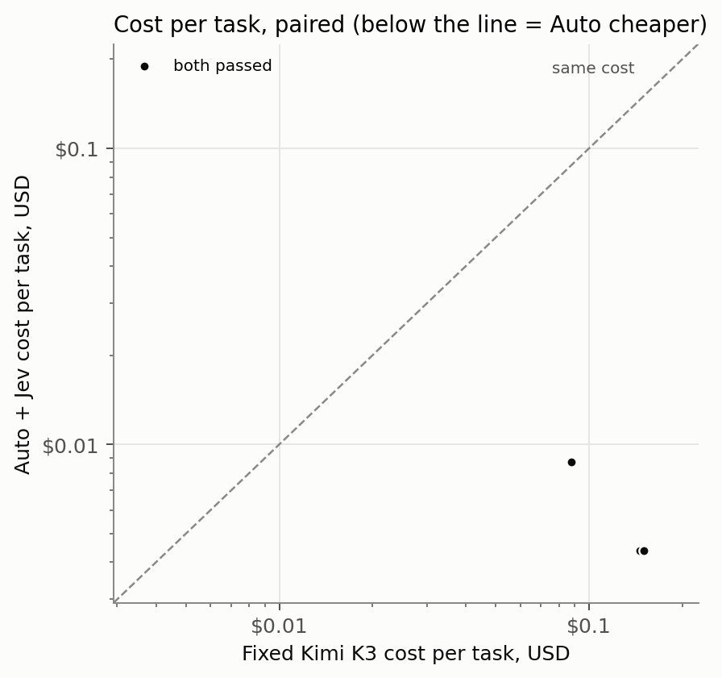

# Results: smoke-1

Generated from `runs/smoke-1/` by `bench/analyze.py` and `bench/report.py`. Every number below can be traced to
`results.jsonl` and the raw files of the execution named in the per-task table.

- Executions: 6 (task executions; each makes many model API requests, counted separately below).
- nconnect v0.23.0 (bundle `db122e275473…`, source `66bf93f`), 2.1.299 (Claude Code), Node v24.18.1, Python 3.11.5.
- Prices: Nebius catalog captured 2026-10-14T16:08:18.883Z; Jev jev-1.13.0 at $0.042/M input tokens.
- Costs are **estimates** from provider-reported tokens and those prices, not reconciled against Nebius billing. Cached input
  is charged at the full input rate (Nebius publishes no cached price); the cache-free lower bound is shown alongside.
- Run events: prepared; run started; run complete.

## Headline (paired tasks)

- Paired tasks: **3**.
- Quality: Auto minus fixed = **+0.0 percentage points** [+0.0, +0.0] (bootstrap 95% CI). Exact McNemar p = 1.000 on 0 discordant pairs.
- Cost: fixed $0.3836, Auto $0.0175. Savings **95.4%** [90.0%, 97.1%], i.e. a cost-reduction factor of **21.89×** ($0.3661 saved). Auto was cheaper on 3 of 3 tasks.
- Time: total fixed 22 s, Auto 29 s; speedup by total time **0.76×**, by median 1.14×, geometric mean over the 3 tasks both passed 0.81× [0.40×, 1.14×]. Auto was faster on 2 of those 3.
- Speedup above 1× means Auto finished faster; below 1× means slower.

## Scorecard

| Metric | A: fixed Kimi K3 | B: Auto + Jev |
|---|---|---|
| Tasks passed | 3/3 | 3/3 |
| Success rate (95% CI) | 100.0% [43.8%, 100.0%] | 100.0% [43.8%, 100.0%] |
| Total execution cost, estimated (incl. failed tasks) | $0.3836 | $0.0175 |
|   of which foreground inference | $0.3836 | $0.0175 |
|   of which background calls | $0.0000 | $0.0000 |
|   of which Jev routing | $0.0000 | $0.0000 |
|   of which unmetered (estimated from bytes) | $0.0000 | $0.0000 |
|   spent on failed tasks | $0.0000 | $0.0000 |
| Lower bound if cached input were free | $0.1129 | $0.0064 |
| Average cost per attempted task | $0.1279 | $0.0058 |
| Cost per successful task | $0.1279 | $0.0058 |
| Successful tasks per dollar | 7.8 | 171.2 |
| Successful tasks per hour (one at a time) | 488.7 | 370.9 |
| Median completion time | 8.0 s | 7.0 s |
| p95 completion time | 8.0 s | 14 s |
| Median time to first output | 2.3 s | 2.5 s |
| Total wall time | 22 s | 29 s |
| Input tokens (cached share) | 118,924 (76%) | 112,790 (66%) |
| Output tokens (reasoning reported) | 1,791 (0) | 1,208 (26) |
| Tokens per task / per success | 40,238 / 40,238 | 37,999 / 37,999 |
| Model requests per task | 4.3 | 4.0 |
| Tool calls per task | 3.3 | 3.0 |
| Failed tool calls | 2 | 0 |
| Upstream retries / errors / without usage | 0 / 0 / 0 | 0 / 0 / 0 |
| Sessions stopped by a limit | none | none |
| Auto escalations (tasks with stuck → strong) | n/a | 0 (0 stuck routes) |
| Anomalies / contamination flags | 0 / 0 | 0 / 0 |

## Paired outcomes

| Tasks | Both pass | Only fixed passes | Only Auto passes | Both fail | McNemar p |
|---|---|---|---|---|---|
| all | 3 | 0 | 0 | 0 | 1.000 |
| easy | 3 | 0 | 0 | 0 | 1.000 |

## By difficulty

| Difficulty | Tasks | Passed A / B | Cost A / B | Savings | Cost per success A / B | Median time A / B |
|---|---|---|---|---|---|---|
| easy | 3 | 3 / 3 | $0.3836 / $0.0175 | 95% | $0.1279 / $0.0058 | 8.0 s / 7.0 s |

## By category

| Category | Tasks | Passed A / B | Cost A / B | Savings | Cost per success A / B | Median time A / B |
|---|---|---|---|---|---|---|
| bugfix | 1 | 1 / 1 | $0.0875 / $0.0088 | 90% | $0.0875 / $0.0088 | 6.0 s / 15 s |
| formatting | 1 | 1 / 1 | $0.1501 / $0.0044 | 97% | $0.1501 / $0.0044 | 8.0 s / 7.0 s |
| utility | 1 | 1 / 1 | $0.1460 / $0.0044 | 97% | $0.1460 / $0.0044 | 8.0 s / 7.0 s |

## Where the work and the money went

| Condition | Model | Requests (share) | Tokens (share) | Spend (share) |
|---|---|---|---|---|
| A | moonshotai/Kimi-K3 | 13 (100%) | 120,715 (100%) | $0.3836 (100%) |
| B_rules | zai-org/GLM-5.3-Flash | 12 (100%) | 113,998 (100%) | $0.0175 (100%) |

## Auto's routing

First tier Auto chose for each task, by the evaluator's difficulty label (a diagnostic, not a quality measure):

| Difficulty | fast | balanced | strong | none |
|---|---|---|---|---|
| easy | 3 | 0 | 0 | 0 |

Jev's own choice on the task prompt:

| Difficulty | routine | moderate | hard | none |
|---|---|---|---|---|
| easy | 0 | 0 | 0 | 3 |

- Model requests by tier: {"fast": 12}; by reason: {"routine": 12}.
- Tasks that escalated: 0; tasks that reached the strong tier at some point: 0.
- Jev calls: 0 (task decisions plus one warm-up per session), cost $0.0000; decision latency median n/a ms, p95 n/a ms.
- Jev gave no answer (keyword rules used instead): 0 of 0 decider events; answers that arrived after the 2.5 s wait: 0.
- Jev versions that answered: {"none": 3}.
- Reasoning effort sent upstream (all requests): {"low": 12}.

## Scenarios

Each list includes every task that meets its rule.

### Routine work where routing saved money with a correct result

Rule: Auto's first tier was fast, both conditions passed, Auto cost less. Sorted by savings. Matches: 3.

| Task | Difficulty | Auto tiers | Fixed / Auto | Cost fixed / Auto | Time fixed / Auto | Calls fixed / Auto | Executions |
|---|---|---|---|---|---|---|---|
| smoke-ts-initials | easy | fast | pass / pass | $0.1501 / $0.0044 | 8.0 s / 7.0 s | 5 / 3 | 004, 003 |
| smoke-py-word-count | easy | fast | pass / pass | $0.1460 / $0.0044 | 8.0 s / 7.0 s | 5 / 3 | 001, 002 |
| smoke-py-average-bug | easy | fast | pass / pass | $0.0875 / $0.0088 | 6.0 s / 15 s | 3 / 6 | 005, 006 |

### Work where Auto chose or escalated to the strong model

Rule: Auto's first tier was strong, or it escalated during the task. Matches: 0.

### Routing hurt quality

Rule: Fixed passed and Auto failed. Matches: 0.

### Routing helped quality

Rule: Auto passed and fixed failed. Matches: 0.

### Routing increased completion time

Rule: Both passed and Auto took at least 1.5× as long. Matches: 1.

| Task | Difficulty | Auto tiers | Fixed / Auto | Cost fixed / Auto | Time fixed / Auto | Calls fixed / Auto | Executions |
|---|---|---|---|---|---|---|---|
| smoke-py-average-bug | easy | fast | pass / pass | $0.0875 / $0.0088 | 6.0 s / 15 s | 3 / 6 | 005, 006 |

### The fixed model was the better choice on cost too

Rule: Both passed and Auto cost more than fixed Kimi K3. Matches: 0.

### Cheaper per token, not cheaper per task

Rule: Auto made at least 1.5× as many model calls as fixed (longer sessions on cheaper models). Matches: 1.

| Task | Difficulty | Auto tiers | Fixed / Auto | Cost fixed / Auto | Time fixed / Auto | Calls fixed / Auto | Executions |
|---|---|---|---|---|---|---|---|
| smoke-py-average-bug | easy | fast | pass / pass | $0.0875 / $0.0088 | 6.0 s / 15 s | 3 / 6 | 005, 006 |

## Per task

| Task | Difficulty | Fixed model(s) | Auto model(s) / tiers | Fixed | Auto | Fixed cost | Auto cost | Savings | Fixed time | Auto time | Notable |
|---|---|---|---|---|---|---|---|---|---|---|---|
| smoke-py-average-bug | easy | Kimi K3×3 | GLM 5.3 Flash×6 (fast) | pass | pass | $0.0875 | $0.0088 | 90.0% | 6.0 s | 15 s | Auto took 6 model calls vs 3 |
| smoke-py-word-count | easy | Kimi K3×5 | GLM 5.3 Flash×3 (fast) | pass | pass | $0.1460 | $0.0044 | 97.0% | 8.0 s | 7.0 s |  |
| smoke-ts-initials | easy | Kimi K3×5 | GLM 5.3 Flash×3 (fast) | pass | pass | $0.1501 | $0.0044 | 97.1% | 8.0 s | 7.0 s |  |

## Charts

