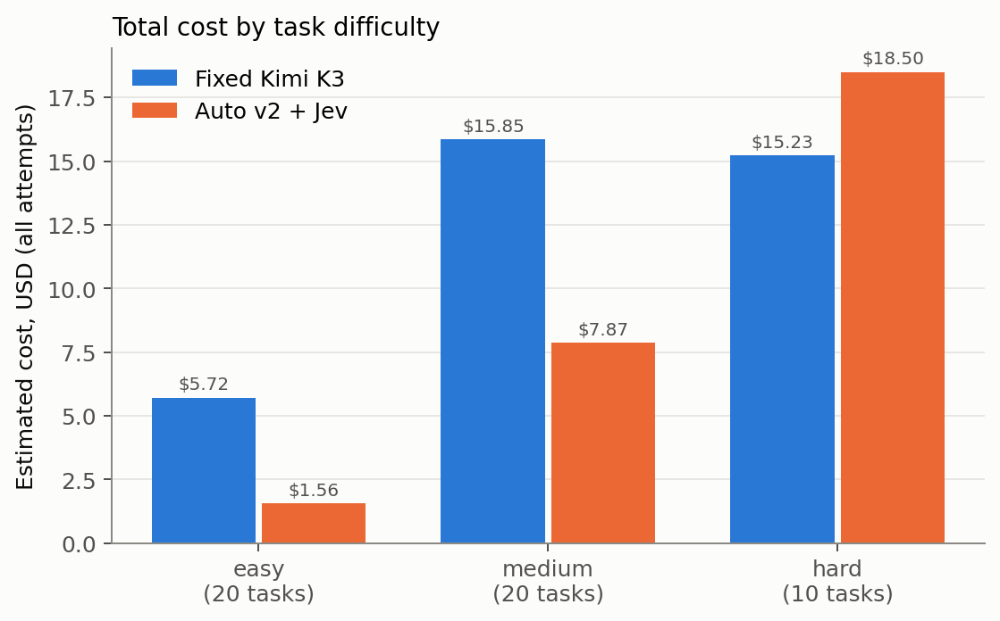
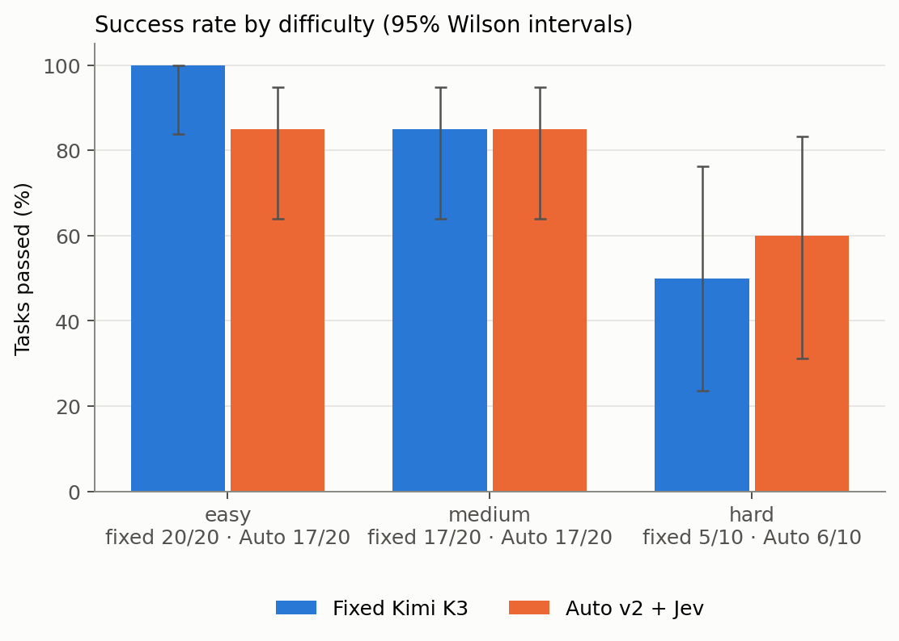
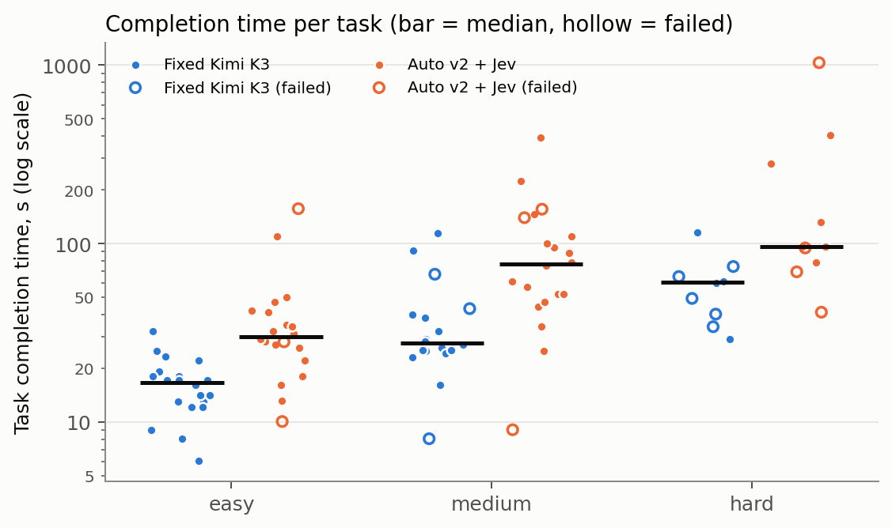
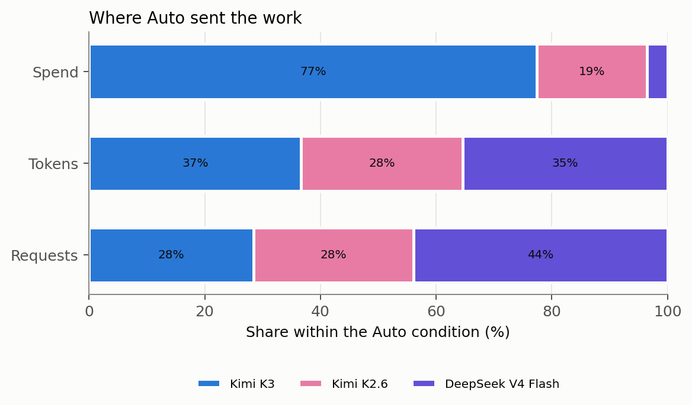
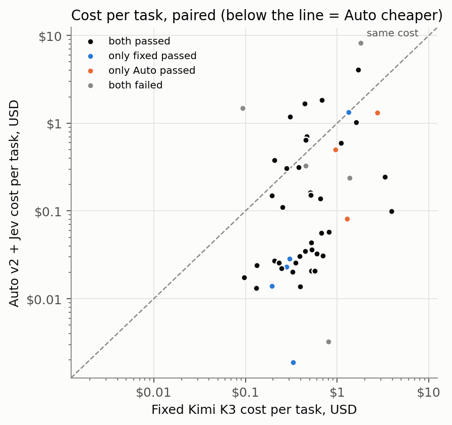

# Results: v2

Generated from `runs/v2/` by `bench/analyze.py` and `bench/report.py`. Every number below can be traced to
`results.jsonl` and the raw files of the execution named in the per-task table.

- Condition A taken from: `runs/main/`; condition C from `runs/v2/`.
- Executions: 100 (task executions; each makes many model API requests, counted separately below).
- nconnect v0.23.0 (bundle `db122e275473…`, source `66bf93f`), 2.1.299 (Claude Code), Node v24.18.1, Python 3.11.5.
- Condition C runs its own nconnect build: `vendor/nconnect-0.23.0-autov2.2.js` (sha256 `1e392f7eb140…`, source `12ad392`).
- Prices: Nebius catalog captured 2026-10-15T11:07:41.795Z; Jev jev-1.13.0 at $0.042/M input tokens.
- Costs are **estimates** from provider-reported tokens and those prices, not reconciled against Nebius billing. Cached input
  is charged at the full input rate (Nebius publishes no cached price); the cache-free lower bound is shown alongside.
- Run events: prepared; run started; infrastructure failure: excluded and queued for re-run; run started; provider unhealthy; waiting; provider unhealthy; waiting; kept interrupted attempt; run complete.

## Headline (paired tasks)

- Paired tasks: **50**.
- Quality: Auto minus fixed = **-4.0 percentage points** [-16.0, +6.0] (bootstrap 95% CI). Exact McNemar p = 0.727 on 8 discordant pairs.
- Cost: fixed $36.79, Auto $27.93. Savings **24.1%** [-31.0%, 63.4%], i.e. a cost-reduction factor of **1.32×** ($8.87 saved). Auto was cheaper on 39 of 50 tasks.
- Time: total fixed 27.8 min, Auto 85.3 min; speedup by total time **0.33×**, by median 0.48×, geometric mean over the 37 tasks both passed 0.46× [0.38×, 0.56×]. Auto was faster on 5 of those 37.
- Speedup above 1× means Auto finished faster; below 1× means slower.

## Excluded executions (Amendments 1 and 2)

Executions excluded as provider outages (Amendment 1) or host sleep (Amendment 2), and re-run. Evidence is kept:

| Task | Condition | Execution | Cost | Duration | Reason | Evidence |
|---|---|---|---|---|---|---|
| js-parse-ini | C | 012 | $5.63 | 20.0 min | infrastructure failure: 4 of 77 model requests got no provider response (moonshotai/Kimi-K3) | `attempts/012-r1-js-parse-ini-C.infra-1` |
| py-inventory-reservations | A | 089 | $0.9867 | 2.3 min | infrastructure failure: the host machine was asleep for 94 s of its 140 s | `attempts/089-r1-py-inventory-reservations-A.infra-1` |
| ts-format-money | A | 092 | $0.3795 | 3.9 min | infrastructure failure: the host machine was asleep for 215 s of its 235 s | `attempts/092-r1-ts-format-money-A.infra-1` |
| ts-undo-redo | A | 095 | $0.4588 | 61.8 min | infrastructure failure: the host machine was asleep for 3687 s of its 3708 s | `attempts/095-r1-ts-undo-redo-A.infra-1` |
| js-cli-json-flag | A | 098 | $0.1853 | 33.0 min | infrastructure failure: the host machine was asleep for 1971 s of its 1980 s | `attempts/098-r1-js-cli-json-flag-A.infra-1` |

Sensitivity, using each excluded attempt as the result instead of its re-run: quality difference -6.0 pp, cost savings 7.7%, speedup by total time 1.25×.

## Scorecard

| Metric | A: fixed Kimi K3 | C: Auto v2 + Jev |
|---|---|---|
| Tasks passed | 42/50 | 40/50 |
| Success rate (95% CI) | 84.0% [71.5%, 91.7%] | 80.0% [67.0%, 88.8%] |
| Total execution cost, estimated (incl. failed tasks) | $36.79 | $27.93 |
|   of which foreground inference | $36.79 | $27.89 |
|   of which background calls | $0.0000 | $0.0000 |
|   of which Jev routing | $0.0000 | $0.0024 |
|   of which unmetered (estimated from bytes) | $0.0000 | $0.0306 |
|   spent on failed tasks | $9.51 | $11.67 |
| Lower bound if cached input were free | $5.64 | $4.64 |
| Average cost per attempted task | $0.7359 | $0.5586 |
| Cost per successful task | $0.8760 | $0.6982 |
| Successful tasks per dollar | 1.1 | 1.4 |
| Successful tasks per hour (one at a time) | 90.7 | 28.1 |
| Median completion time | 25 s | 52 s |
| p95 completion time | 84 s | 5.7 min |
| Median time to first output | 1.9 s | 2.8 s |
| Total wall time | 27.8 min | 85.3 min |
| Input tokens (cached share) | 10,909,039 (95%) | 17,773,505 (91%) |
| Output tokens (reasoning reported) | 271,063 (0) | 611,156 (198,722) |
| Tokens per task / per success | 223,602 / 266,193 | 367,693 / 459,617 |
| Model requests per task | 13.4 | 17.0 |
| Tool calls per task | 15.3 | 19.0 |
| Failed tool calls | 146 | 168 |
| Upstream retries / errors / without usage | 0 / 0 / 0 | 0 / 0 / 6 |
| Sessions stopped by a limit | none | request_limit: 1 |
| Auto escalations (tasks with stuck → strong) | n/a | 11 (151 stuck routes) |
| Anomalies / contamination flags | 0 / 0 | 0 / 0 |

## Paired outcomes

| Tasks | Both pass | Only fixed passes | Only Auto passes | Both fail | McNemar p |
|---|---|---|---|---|---|
| all | 37 | 5 | 3 | 5 | 0.727 |
| easy | 17 | 3 | 0 | 0 | 0.250 |
| medium | 16 | 1 | 1 | 2 | 1.000 |
| hard | 4 | 1 | 2 | 3 | 1.000 |

## By difficulty

| Difficulty | Tasks | Passed A / B | Cost A / B | Savings | Cost per success A / B | Median time A / B |
|---|---|---|---|---|---|---|
| easy | 20 | 20 / 17 | $5.72 / $1.56 | 73% | $0.2858 / $0.0917 | 17 s / 30 s |
| medium | 20 | 17 / 17 | $15.85 / $7.87 | 50% | $0.9324 / $0.4627 | 28 s / 77 s |
| hard | 10 | 5 / 6 | $15.23 / $18.50 | -22% | $3.05 / $3.08 | 61 s / 96 s |

## By category

| Category | Tasks | Passed A / B | Cost A / B | Savings | Cost per success A / B | Median time A / B |
|---|---|---|---|---|---|---|
| api-change | 5 | 4 / 3 | $3.19 / $0.3413 | 89% | $0.7971 / $0.1138 | 24 s / 44 s |
| bugfix | 7 | 6 / 5 | $3.44 / $5.23 | -52% | $0.5737 / $1.05 | 23 s / 50 s |
| feature | 5 | 3 / 4 | $3.44 / $0.9441 | 73% | $1.15 / $0.2360 | 25 s / 57 s |
| formatting | 6 | 6 / 5 | $5.12 / $0.6444 | 87% | $0.8526 / $0.1289 | 21 s / 44 s |
| parsing | 6 | 6 / 6 | $5.01 / $5.91 | -18% | $0.8349 / $0.9856 | 39 s / 2.1 min |
| refactor | 4 | 3 / 4 | $2.30 / $0.7840 | 66% | $0.7663 / $0.1960 | 29 s / 26 s |
| state | 5 | 3 / 4 | $5.51 / $11.51 | -109% | $1.84 / $2.88 | 27 s / 88 s |
| utility | 6 | 5 / 4 | $2.43 / $1.76 | 27% | $0.4866 / $0.4411 | 21 s / 32 s |
| validation | 6 | 6 / 5 | $6.35 / $0.7919 | 88% | $1.06 / $0.1584 | 21 s / 87 s |

## Where the work and the money went

| Condition | Model | Requests (share) | Tokens (share) | Spend (share) |
|---|---|---|---|---|
| A | moonshotai/Kimi-K3 | 668 (100%) | 11,180,102 (100%) | $36.79 (100%) |
| C | moonshotai/Kimi-K3 | 242 (28%) | 6,740,552 (37%) | $21.62 (77%) |
| C | moonshotai/Kimi-K2.6 | 235 (28%) | 5,130,930 (28%) | $5.31 (19%) |
| C | deepseek-ai/DeepSeek-V4-Flash-0731 | 373 (44%) | 6,513,179 (35%) | $0.9915 (4%) |

## Auto's routing

First tier Auto chose for each task, by the evaluator's difficulty label (a diagnostic, not a quality measure):

| Difficulty | fast | balanced | strong | none |
|---|---|---|---|---|
| easy | 18 | 2 | 0 | 0 |
| medium | 13 | 5 | 2 | 0 |
| hard | 1 | 7 | 2 | 0 |

Jev's own choice on the task prompt:

| Difficulty | routine | moderate | hard | none |
|---|---|---|---|---|
| easy | 19 | 0 | 1 | 0 |
| medium | 14 | 4 | 2 | 0 |
| hard | 2 | 4 | 4 | 0 |

- Model requests by tier: {"strong": 242, "fast": 373, "balanced": 235}; by reason: {"decider_hard": 91, "decider_routine": 373, "stuck": 151, "decider_moderate": 235}.
- Tasks that escalated: 11; tasks that reached the strong tier at some point: 15.
- Tasks that moved down a tier mid-task: 1; tasks where Jev was asked more than once: 1; tasks where Claude Code resumed after hitting the output-token limit: 2. (nconnect treats Claude Code's "Output token limit hit" message as a new prompt, asks Jev about it, and re-routes the rest of the task.)
- Jev calls: 101 (task decisions plus one warm-up per session), cost $0.0024; decision latency median 342 ms, p95 423 ms.
- Jev gave no answer (keyword rules used instead): 0 of 101 decider events; answers that arrived after the 2.5 s wait: 0.
- Jev versions that answered: {"jev-1.13.0": 50}.
- Reasoning effort sent upstream (all requests): {"none": 477, "low": 373}.

## Scenarios

Each list includes every task that meets its rule.

### Routine work where routing saved money with a correct result

Rule: Auto's first tier was fast, both conditions passed, Auto cost less. Sorted by savings. Matches: 22.

| Task | Difficulty | Auto tiers | Fixed / Auto | Cost fixed / Auto | Time fixed / Auto | Calls fixed / Auto | Executions |
|---|---|---|---|---|---|---|---|
| ts-signup-validate | medium | fast | pass / pass | $3.89 / $0.0990 | 115 s / 100 s | 45 / 24 | 014, 007 |
| ts-notify-many | easy | fast | pass / pass | $0.3946 / $0.0138 | 22 s / 31 s | 10 / 7 | 064, 032 |
| py-shipping-constants | easy | fast | pass / pass | $0.5680 / $0.0206 | 32 s / 27 s | 13 / 10 | 053, 027 |
| py-chunk-evenly | easy | fast | pass / pass | $0.5230 / $0.0207 | 25 s / 26 s | 14 / 12 | 051, 026 |
| js-client-options | medium | fast | pass / pass | $0.7019 / $0.0310 | 28 s / 52 s | 15 / 12 | 056, 028 |
| py-card-iban | medium | fast | pass / pass | $0.6005 / $0.0325 | 26 s / 78 s | 14 / 13 | 029, 015 |
| py-parse-kv | easy | fast | pass / pass | $0.3253 / $0.0201 | 17 s / 32 s | 9 / 11 | 072, 036 |
| js-human-duration | medium | fast | pass / pass | $0.5313 / $0.0363 | 29 s / 52 s | 12 / 13 | 047, 024 |
| py-report-csv-export | medium | fast | pass / pass | $0.8134 / $0.0574 | 25 s / 57 s | 16 / 22 | 093, 047 |
| ts-hex-color | easy | fast | pass / pass | $0.3540 / $0.0255 | 16 s / 110 s | 10 / 10 | 077, 039 |
| ts-table-wrap | hard | fast → strong | pass / pass | $3.32 / $0.2441 | 116 s / 96 s | 39 / 17 | 086, 043 |
| py-user-stats-dataclass | medium | fast | pass / pass | $0.4467 / $0.0350 | 24 s / 44 s | 10 / 16 | 083, 042 |
| js-parse-ini | medium | fast | pass / pass | $0.6680 / $0.0560 | 38 s / 3.8 min | 14 / 15 | 024, 012 |
| py-flatten-records-csv | medium | fast | pass / pass | $0.5235 / $0.0438 | 24 s / 61 s | 13 / 17 | 004, 002 |
| ts-parse-clock | easy | fast | pass / pass | $0.2456 / $0.0221 | 14 s / 28 s | 7 / 11 | 045, 023 |
| js-pluralize | easy | fast | pass / pass | $0.1312 / $0.0132 | 8.1 s / 16 s | 4 / 8 | 032, 016 |
| ts-clamp-range | easy | fast | pass / pass | $0.2306 / $0.0256 | 12 s / 29 s | 7 / 14 | 060, 030 |
| py-validate-username | easy | fast | pass / pass | $0.2056 / $0.0270 | 12 s / 42 s | 6 / 10 | 042, 021 |
| ts-paginate-off-by-one | easy | fast | pass / pass | $0.0969 / $0.0174 | 6.0 s / 22 s | 3 / 10 | 020, 010 |
| js-pick-omit | easy | fast | pass / pass | $0.1324 / $0.0240 | 9.1 s / 34 s | 4 / 13 | 068, 034 |
| py-memoize | easy | fast → strong | pass / pass | $0.1953 / $0.1501 | 19 s / 41 s | 5 / 10 | 010, 005 |
| js-cli-json-flag | easy | fast → strong | pass / pass | $0.3804 / $0.3161 | 18 s / 47 s | 10 / 17 | 098, 049 |

### Routing saved money with a correct result (any tier)

Rule: Both conditions passed and Auto cost less. Sorted by savings. Matches: 29.

| Task | Difficulty | Auto tiers | Fixed / Auto | Cost fixed / Auto | Time fixed / Auto | Calls fixed / Auto | Executions |
|---|---|---|---|---|---|---|---|
| ts-signup-validate | medium | fast | pass / pass | $3.89 / $0.0990 | 115 s / 100 s | 45 / 24 | 014, 007 |
| ts-notify-many | easy | fast | pass / pass | $0.3946 / $0.0138 | 22 s / 31 s | 10 / 7 | 064, 032 |
| py-shipping-constants | easy | fast | pass / pass | $0.5680 / $0.0206 | 32 s / 27 s | 13 / 10 | 053, 027 |
| py-chunk-evenly | easy | fast | pass / pass | $0.5230 / $0.0207 | 25 s / 26 s | 14 / 12 | 051, 026 |
| js-client-options | medium | fast | pass / pass | $0.7019 / $0.0310 | 28 s / 52 s | 15 / 12 | 056, 028 |
| py-card-iban | medium | fast | pass / pass | $0.6005 / $0.0325 | 26 s / 78 s | 14 / 13 | 029, 015 |
| py-parse-kv | easy | fast | pass / pass | $0.3253 / $0.0201 | 17 s / 32 s | 9 / 11 | 072, 036 |
| js-human-duration | medium | fast | pass / pass | $0.5313 / $0.0363 | 29 s / 52 s | 12 / 13 | 047, 024 |
| py-report-csv-export | medium | fast | pass / pass | $0.8134 / $0.0574 | 25 s / 57 s | 16 / 22 | 093, 047 |
| ts-hex-color | easy | fast | pass / pass | $0.3540 / $0.0255 | 16 s / 110 s | 10 / 10 | 077, 039 |
| ts-table-wrap | hard | fast → strong | pass / pass | $3.32 / $0.2441 | 116 s / 96 s | 39 / 17 | 086, 043 |
| py-user-stats-dataclass | medium | fast | pass / pass | $0.4467 / $0.0350 | 24 s / 44 s | 10 / 16 | 083, 042 |
| py-shared-default-tags | easy | balanced | pass / pass | $0.3880 / $0.0305 | 23 s / 13 s | 10 / 3 | 081, 041 |
| js-parse-ini | medium | fast | pass / pass | $0.6680 / $0.0560 | 38 s / 3.8 min | 14 / 15 | 024, 012 |
| py-flatten-records-csv | medium | fast | pass / pass | $0.5235 / $0.0438 | 24 s / 61 s | 13 / 17 | 004, 002 |
| ts-parse-clock | easy | fast | pass / pass | $0.2456 / $0.0221 | 14 s / 28 s | 7 / 11 | 045, 023 |
| js-pluralize | easy | fast | pass / pass | $0.1312 / $0.0132 | 8.1 s / 16 s | 4 / 8 | 032, 016 |
| ts-clamp-range | easy | fast | pass / pass | $0.2306 / $0.0256 | 12 s / 29 s | 7 / 14 | 060, 030 |
| py-validate-username | easy | fast | pass / pass | $0.2056 / $0.0270 | 12 s / 42 s | 6 / 10 | 042, 021 |
| ts-paginate-off-by-one | easy | fast | pass / pass | $0.0969 / $0.0174 | 6.0 s / 22 s | 3 / 10 | 020, 010 |
| js-pick-omit | easy | fast | pass / pass | $0.1324 / $0.0240 | 9.1 s / 34 s | 4 / 13 | 068, 034 |
| py-weekly-report-bugs | medium | balanced | pass / pass | $0.6518 / $0.1391 | 32 s / 34 s | 15 / 11 | 026, 013 |
| py-extract-validators | medium | balanced | pass / pass | $0.5150 / $0.1524 | 25 s / 25 s | 11 / 11 | 049, 025 |
| js-site-plugins | medium | balanced | pass / pass | $0.5077 / $0.1611 | 25 s / 47 s | 11 / 11 | 099, 050 |
| ts-config-promise | easy | balanced | pass / pass | $0.2523 / $0.1100 | 17 s / 18 s | 7 / 10 | 021, 011 |
| ts-schema-validator | hard | balanced | pass / pass | $1.11 / $0.5938 | 60 s / 96 s | 19 / 24 | 044, 022 |
| ts-semver-range | medium | balanced | pass / pass | $1.61 / $1.03 | 91 s / 2.4 min | 20 / 25 | 017, 009 |
| py-memoize | easy | fast → strong | pass / pass | $0.1953 / $0.1501 | 19 s / 41 s | 5 / 10 | 010, 005 |
| js-cli-json-flag | easy | fast → strong | pass / pass | $0.3804 / $0.3161 | 18 s / 47 s | 10 / 17 | 098, 049 |

### Work where Auto chose or escalated to the strong model

Rule: Auto's first tier was strong, or it escalated during the task. Matches: 15.

| Task | Difficulty | Auto tiers | Fixed / Auto | Cost fixed / Auto | Time fixed / Auto | Calls fixed / Auto | Executions |
|---|---|---|---|---|---|---|---|
| js-cli-json-flag | easy | fast → strong | pass / pass | $0.3804 / $0.3161 | 18 s / 47 s | 10 / 17 | 098, 049 |
| js-debounce-bugs | medium | strong | pass / pass | $0.6789 / $1.84 | 40 s / 6.5 min | 13 / 25 | 002, 001 |
| js-score-sort | easy | fast → strong | pass / pass | $0.2079 / $0.3783 | 13 s / 50 s | 6 / 16 | 015, 008 |
| py-async-rate-limiter | hard | strong → fast | FAIL / pass | $2.74 / $1.32 | 74 s / 6.8 min | 34 / 27 | 027, 014 |
| py-cron-next | hard | balanced → strong | pass / pass | $0.4439 / $1.66 | 29 s / 2.2 min | 9 / 28 | 074, 037 |
| py-expr-eval | hard | balanced → strong | pass / pass | $1.70 / $4.07 | 61 s / 4.7 min | 26 / 49 | 033, 017 |
| py-format-phone | easy | fast → strong | pass / pass | $0.2789 / $0.3051 | 18 s / 35 s | 8 / 13 | 039, 020 |
| py-inventory-reservations | hard | strong | pass / FAIL | $1.33 / $1.33 | 61 s / 94 s | 23 / 23 | 089, 045 |
| py-memoize | easy | fast → strong | pass / pass | $0.1953 / $0.1501 | 19 s / 41 s | 5 / 10 | 010, 005 |
| py-order-state-machine | medium | balanced → strong | pass / pass | $0.3068 / $1.19 | 27 s / 75 s | 7 / 30 | 080, 040 |
| py-parse-query | medium | fast → strong | pass / pass | $0.4638 / $0.7110 | 39 s / 110 s | 9 / 25 | 011, 006 |
| ts-emitter-bugs | medium | strong | FAIL / FAIL | $0.0927 / $1.49 | 8.1 s / 2.6 min | 3 / 24 | 066, 033 |
| ts-singleflight-cache | hard | balanced → strong | FAIL / FAIL | $1.81 / $8.21 | 65 s / 17.2 min | 28 / 81 | 036, 018 |
| ts-table-wrap | hard | fast → strong | pass / pass | $3.32 / $0.2441 | 116 s / 96 s | 39 / 17 | 086, 043 |
| ts-weighted-lru | medium | fast → strong | pass / pass | $0.4554 / $0.6460 | 23 s / 88 s | 11 / 20 | 076, 038 |

### Routing hurt quality

Rule: Fixed passed and Auto failed. Matches: 5.

| Task | Difficulty | Auto tiers | Fixed / Auto | Cost fixed / Auto | Time fixed / Auto | Calls fixed / Auto | Executions |
|---|---|---|---|---|---|---|---|
| js-email-list | easy | fast | pass / FAIL | $0.1946 / $0.0140 | 13 s / 28 s | 5 / 8 | 061, 031 |
| py-inventory-reservations | hard | strong | pass / FAIL | $1.33 / $1.33 | 61 s / 94 s | 23 / 23 | 089, 045 |
| py-retry-backoff | medium | fast | pass / FAIL | $0.3012 / $0.0284 | 16 s / 2.3 min | 8 / 11 | 057, 029 |
| py-top-n-reverse | easy | fast | pass / FAIL | $0.2801 / $0.0232 | 14 s / 2.6 min | 8 / 5 | 087, 044 |
| ts-format-money | easy | fast | pass / FAIL | $0.3322 / $0.0019 | 17 s / 10 s | 10 / 1 | 092, 046 |

### Routing helped quality

Rule: Auto passed and fixed failed. Matches: 3.

| Task | Difficulty | Auto tiers | Fixed / Auto | Cost fixed / Auto | Time fixed / Auto | Calls fixed / Auto | Executions |
|---|---|---|---|---|---|---|---|
| py-async-rate-limiter | hard | strong → fast | FAIL / pass | $2.74 / $1.32 | 74 s / 6.8 min | 34 / 27 | 027, 014 |
| ts-pricing-rules | hard | balanced | FAIL / pass | $0.9636 / $0.5011 | 40 s / 78 s | 17 / 23 | 070, 035 |
| ts-todo-query | medium | fast | FAIL / pass | $1.29 / $0.0813 | 67 s / 95 s | 21 / 20 | 007, 004 |

### Routing increased completion time

Rule: Both passed and Auto took at least 1.5× as long. Matches: 28.

| Task | Difficulty | Auto tiers | Fixed / Auto | Cost fixed / Auto | Time fixed / Auto | Calls fixed / Auto | Executions |
|---|---|---|---|---|---|---|---|
| js-cli-json-flag | easy | fast → strong | pass / pass | $0.3804 / $0.3161 | 18 s / 47 s | 10 / 17 | 098, 049 |
| js-client-options | medium | fast | pass / pass | $0.7019 / $0.0310 | 28 s / 52 s | 15 / 12 | 056, 028 |
| js-debounce-bugs | medium | strong | pass / pass | $0.6789 / $1.84 | 40 s / 6.5 min | 13 / 25 | 002, 001 |
| js-human-duration | medium | fast | pass / pass | $0.5313 / $0.0363 | 29 s / 52 s | 12 / 13 | 047, 024 |
| js-parse-ini | medium | fast | pass / pass | $0.6680 / $0.0560 | 38 s / 3.8 min | 14 / 15 | 024, 012 |
| js-pick-omit | easy | fast | pass / pass | $0.1324 / $0.0240 | 9.1 s / 34 s | 4 / 13 | 068, 034 |
| js-pluralize | easy | fast | pass / pass | $0.1312 / $0.0132 | 8.1 s / 16 s | 4 / 8 | 032, 016 |
| js-score-sort | easy | fast → strong | pass / pass | $0.2079 / $0.3783 | 13 s / 50 s | 6 / 16 | 015, 008 |
| js-site-plugins | medium | balanced | pass / pass | $0.5077 / $0.1611 | 25 s / 47 s | 11 / 11 | 099, 050 |
| py-card-iban | medium | fast | pass / pass | $0.6005 / $0.0325 | 26 s / 78 s | 14 / 13 | 029, 015 |
| py-cron-next | hard | balanced → strong | pass / pass | $0.4439 / $1.66 | 29 s / 2.2 min | 9 / 28 | 074, 037 |
| py-expr-eval | hard | balanced → strong | pass / pass | $1.70 / $4.07 | 61 s / 4.7 min | 26 / 49 | 033, 017 |
| py-flatten-records-csv | medium | fast | pass / pass | $0.5235 / $0.0438 | 24 s / 61 s | 13 / 17 | 004, 002 |
| py-format-phone | easy | fast → strong | pass / pass | $0.2789 / $0.3051 | 18 s / 35 s | 8 / 13 | 039, 020 |
| py-memoize | easy | fast → strong | pass / pass | $0.1953 / $0.1501 | 19 s / 41 s | 5 / 10 | 010, 005 |
| py-order-state-machine | medium | balanced → strong | pass / pass | $0.3068 / $1.19 | 27 s / 75 s | 7 / 30 | 080, 040 |
| py-parse-kv | easy | fast | pass / pass | $0.3253 / $0.0201 | 17 s / 32 s | 9 / 11 | 072, 036 |
| py-parse-query | medium | fast → strong | pass / pass | $0.4638 / $0.7110 | 39 s / 110 s | 9 / 25 | 011, 006 |
| py-report-csv-export | medium | fast | pass / pass | $0.8134 / $0.0574 | 25 s / 57 s | 16 / 22 | 093, 047 |
| py-user-stats-dataclass | medium | fast | pass / pass | $0.4467 / $0.0350 | 24 s / 44 s | 10 / 16 | 083, 042 |
| py-validate-username | easy | fast | pass / pass | $0.2056 / $0.0270 | 12 s / 42 s | 6 / 10 | 042, 021 |
| ts-clamp-range | easy | fast | pass / pass | $0.2306 / $0.0256 | 12 s / 29 s | 7 / 14 | 060, 030 |
| ts-hex-color | easy | fast | pass / pass | $0.3540 / $0.0255 | 16 s / 110 s | 10 / 10 | 077, 039 |
| ts-paginate-off-by-one | easy | fast | pass / pass | $0.0969 / $0.0174 | 6.0 s / 22 s | 3 / 10 | 020, 010 |
| ts-parse-clock | easy | fast | pass / pass | $0.2456 / $0.0221 | 14 s / 28 s | 7 / 11 | 045, 023 |
| ts-schema-validator | hard | balanced | pass / pass | $1.11 / $0.5938 | 60 s / 96 s | 19 / 24 | 044, 022 |
| ts-semver-range | medium | balanced | pass / pass | $1.61 / $1.03 | 91 s / 2.4 min | 20 / 25 | 017, 009 |
| ts-weighted-lru | medium | fast → strong | pass / pass | $0.4554 / $0.6460 | 23 s / 88 s | 11 / 20 | 076, 038 |

### The fixed model was the better choice on cost too

Rule: Both passed and Auto cost more than fixed Kimi K3. Matches: 8.

| Task | Difficulty | Auto tiers | Fixed / Auto | Cost fixed / Auto | Time fixed / Auto | Calls fixed / Auto | Executions |
|---|---|---|---|---|---|---|---|
| js-debounce-bugs | medium | strong | pass / pass | $0.6789 / $1.84 | 40 s / 6.5 min | 13 / 25 | 002, 001 |
| js-score-sort | easy | fast → strong | pass / pass | $0.2079 / $0.3783 | 13 s / 50 s | 6 / 16 | 015, 008 |
| py-cron-next | hard | balanced → strong | pass / pass | $0.4439 / $1.66 | 29 s / 2.2 min | 9 / 28 | 074, 037 |
| py-expr-eval | hard | balanced → strong | pass / pass | $1.70 / $4.07 | 61 s / 4.7 min | 26 / 49 | 033, 017 |
| py-format-phone | easy | fast → strong | pass / pass | $0.2789 / $0.3051 | 18 s / 35 s | 8 / 13 | 039, 020 |
| py-order-state-machine | medium | balanced → strong | pass / pass | $0.3068 / $1.19 | 27 s / 75 s | 7 / 30 | 080, 040 |
| py-parse-query | medium | fast → strong | pass / pass | $0.4638 / $0.7110 | 39 s / 110 s | 9 / 25 | 011, 006 |
| ts-weighted-lru | medium | fast → strong | pass / pass | $0.4554 / $0.6460 | 23 s / 88 s | 11 / 20 | 076, 038 |

### Cheaper per token, not cheaper per task

Rule: Auto made at least 1.5× as many model calls as fixed (longer sessions on cheaper models). Matches: 21.

| Task | Difficulty | Auto tiers | Fixed / Auto | Cost fixed / Auto | Time fixed / Auto | Calls fixed / Auto | Executions |
|---|---|---|---|---|---|---|---|
| js-cli-json-flag | easy | fast → strong | pass / pass | $0.3804 / $0.3161 | 18 s / 47 s | 10 / 17 | 098, 049 |
| js-debounce-bugs | medium | strong | pass / pass | $0.6789 / $1.84 | 40 s / 6.5 min | 13 / 25 | 002, 001 |
| js-email-list | easy | fast | pass / FAIL | $0.1946 / $0.0140 | 13 s / 28 s | 5 / 8 | 061, 031 |
| js-pick-omit | easy | fast | pass / pass | $0.1324 / $0.0240 | 9.1 s / 34 s | 4 / 13 | 068, 034 |
| js-pluralize | easy | fast | pass / pass | $0.1312 / $0.0132 | 8.1 s / 16 s | 4 / 8 | 032, 016 |
| js-score-sort | easy | fast → strong | pass / pass | $0.2079 / $0.3783 | 13 s / 50 s | 6 / 16 | 015, 008 |
| py-cron-next | hard | balanced → strong | pass / pass | $0.4439 / $1.66 | 29 s / 2.2 min | 9 / 28 | 074, 037 |
| py-expr-eval | hard | balanced → strong | pass / pass | $1.70 / $4.07 | 61 s / 4.7 min | 26 / 49 | 033, 017 |
| py-format-phone | easy | fast → strong | pass / pass | $0.2789 / $0.3051 | 18 s / 35 s | 8 / 13 | 039, 020 |
| py-memoize | easy | fast → strong | pass / pass | $0.1953 / $0.1501 | 19 s / 41 s | 5 / 10 | 010, 005 |
| py-order-state-machine | medium | balanced → strong | pass / pass | $0.3068 / $1.19 | 27 s / 75 s | 7 / 30 | 080, 040 |
| py-parse-query | medium | fast → strong | pass / pass | $0.4638 / $0.7110 | 39 s / 110 s | 9 / 25 | 011, 006 |
| py-user-stats-dataclass | medium | fast | pass / pass | $0.4467 / $0.0350 | 24 s / 44 s | 10 / 16 | 083, 042 |
| py-validate-username | easy | fast | pass / pass | $0.2056 / $0.0270 | 12 s / 42 s | 6 / 10 | 042, 021 |
| ts-clamp-range | easy | fast | pass / pass | $0.2306 / $0.0256 | 12 s / 29 s | 7 / 14 | 060, 030 |
| ts-emitter-bugs | medium | strong | FAIL / FAIL | $0.0927 / $1.49 | 8.1 s / 2.6 min | 3 / 24 | 066, 033 |
| ts-paginate-off-by-one | easy | fast | pass / pass | $0.0969 / $0.0174 | 6.0 s / 22 s | 3 / 10 | 020, 010 |
| ts-parse-clock | easy | fast | pass / pass | $0.2456 / $0.0221 | 14 s / 28 s | 7 / 11 | 045, 023 |
| ts-singleflight-cache | hard | balanced → strong | FAIL / FAIL | $1.81 / $8.21 | 65 s / 17.2 min | 28 / 81 | 036, 018 |
| ts-undo-redo | hard | balanced | FAIL / FAIL | $0.4530 / $0.3282 | 34 s / 69 s | 9 / 17 | 095, 048 |
| ts-weighted-lru | medium | fast → strong | pass / pass | $0.4554 / $0.6460 | 23 s / 88 s | 11 / 20 | 076, 038 |

## Per task

| Task | Difficulty | Fixed model(s) | Auto model(s) / tiers | Fixed | Auto | Fixed cost | Auto cost | Savings | Fixed time | Auto time | Notable |
|---|---|---|---|---|---|---|---|---|---|---|---|
| js-cli-json-flag | easy | Kimi K3×10 | DeepSeek V4 Flash×12 + Kimi K3×5 (fast → strong) | pass | pass | $0.3804 | $0.3161 | 16.9% | 18 s | 47 s | Auto escalated 1×; stuck → strong; Auto took 17 model calls vs 10 |
| js-client-options | medium | Kimi K3×15 | DeepSeek V4 Flash×12 (fast) | pass | pass | $0.7019 | $0.0310 | 95.6% | 28 s | 52 s |  |
| js-debounce-bugs | medium | Kimi K3×13 | Kimi K3×25 (strong) | pass | pass | $0.6789 | $1.84 | -170.6% | 40 s | 6.5 min | Auto cost more; Auto took 25 model calls vs 13 |
| js-email-list | easy | Kimi K3×5 | DeepSeek V4 Flash×8 (fast) | pass | FAIL | $0.1946 | $0.0140 | 92.8% | 13 s | 28 s | only fixed passed |
| js-human-duration | medium | Kimi K3×12 | DeepSeek V4 Flash×13 (fast) | pass | pass | $0.5313 | $0.0363 | 93.2% | 29 s | 52 s |  |
| js-parse-ini | medium | Kimi K3×14 | DeepSeek V4 Flash×15 (fast) | pass | pass | $0.6680 | $0.0560 | 91.6% | 38 s | 3.8 min |  |
| js-pick-omit | easy | Kimi K3×4 | DeepSeek V4 Flash×13 (fast) | pass | pass | $0.1324 | $0.0240 | 81.9% | 9.1 s | 34 s | Auto took 13 model calls vs 4 |
| js-pluralize | easy | Kimi K3×4 | DeepSeek V4 Flash×8 (fast) | pass | pass | $0.1312 | $0.0132 | 90.0% | 8.1 s | 16 s | Auto took 8 model calls vs 4 |
| js-score-sort | easy | Kimi K3×6 | Kimi K3×9 + DeepSeek V4 Flash×7 (fast → strong) | pass | pass | $0.2079 | $0.3783 | -82.0% | 13 s | 50 s | Auto escalated 1×; stuck → strong; Auto cost more; Auto took 16 model calls vs 6 |
| js-site-plugins | medium | Kimi K3×11 | Kimi K2.6×11 (balanced) | pass | pass | $0.5077 | $0.1611 | 68.3% | 25 s | 47 s |  |
| py-async-rate-limiter | hard | Kimi K3×34 | Kimi K3×19 + DeepSeek V4 Flash×8 (strong → fast) | FAIL | pass | $2.74 | $1.32 | 51.9% | 74 s | 6.8 min | only Auto passed |
| py-card-iban | medium | Kimi K3×14 | DeepSeek V4 Flash×13 (fast) | pass | pass | $0.6005 | $0.0325 | 94.6% | 26 s | 78 s |  |
| py-chunk-evenly | easy | Kimi K3×14 | DeepSeek V4 Flash×12 (fast) | pass | pass | $0.5230 | $0.0207 | 96.0% | 25 s | 26 s |  |
| py-cron-next | hard | Kimi K3×9 | Kimi K3×19 + Kimi K2.6×9 (balanced → strong) | pass | pass | $0.4439 | $1.66 | -274.6% | 29 s | 2.2 min | Auto escalated 1×; stuck → strong; Auto cost more; Auto took 28 model calls vs 9 |
| py-cursor-pagination | hard | Kimi K3×23 | Kimi K2.6×14 (balanced) | FAIL | FAIL | $1.37 | $0.2383 | 82.5% | 49 s | 41 s |  |
| py-expr-eval | hard | Kimi K3×26 | Kimi K3×34 + Kimi K2.6×15 (balanced → strong) | pass | pass | $1.70 | $4.07 | -139.7% | 61 s | 4.7 min | Auto escalated 1×; stuck → strong; Auto cost more; Auto took 49 model calls vs 26 |
| py-extract-validators | medium | Kimi K3×11 | Kimi K2.6×11 (balanced) | pass | pass | $0.5150 | $0.1524 | 70.4% | 25 s | 25 s |  |
| py-flatten-records-csv | medium | Kimi K3×13 | DeepSeek V4 Flash×17 (fast) | pass | pass | $0.5235 | $0.0438 | 91.6% | 24 s | 61 s |  |
| py-format-phone | easy | Kimi K3×8 | Kimi K3×7 + DeepSeek V4 Flash×6 (fast → strong) | pass | pass | $0.2789 | $0.3051 | -9.4% | 18 s | 35 s | Auto escalated 1×; stuck → strong; Auto cost more; Auto took 13 model calls vs 8 |
| py-inventory-reservations | hard | Kimi K3×23 | Kimi K3×23 (strong) | pass | FAIL | $1.33 | $1.33 | -0.6% | 61 s | 94 s | only fixed passed; Auto cost more |
| py-memoize | easy | Kimi K3×5 | DeepSeek V4 Flash×7 + Kimi K3×3 (fast → strong) | pass | pass | $0.1953 | $0.1501 | 23.2% | 19 s | 41 s | Auto escalated 1×; stuck → strong; Auto took 10 model calls vs 5 |
| py-order-state-machine | medium | Kimi K3×7 | Kimi K3×16 + Kimi K2.6×14 (balanced → strong) | pass | pass | $0.3068 | $1.19 | -288.2% | 27 s | 75 s | Auto escalated 1×; stuck → strong; Auto cost more; Auto took 30 model calls vs 7 |
| py-parse-kv | easy | Kimi K3×9 | DeepSeek V4 Flash×11 (fast) | pass | pass | $0.3253 | $0.0201 | 93.8% | 17 s | 32 s |  |
| py-parse-query | medium | Kimi K3×9 | DeepSeek V4 Flash×13 + Kimi K3×12 (fast → strong) | pass | pass | $0.4638 | $0.7110 | -53.3% | 39 s | 110 s | Auto escalated 1×; stuck → strong; Auto cost more; Auto took 25 model calls vs 9 |
| py-report-csv-export | medium | Kimi K3×16 | DeepSeek V4 Flash×22 (fast) | pass | pass | $0.8134 | $0.0574 | 92.9% | 25 s | 57 s |  |
| py-retry-backoff | medium | Kimi K3×8 | DeepSeek V4 Flash×11 (fast) | pass | FAIL | $0.3012 | $0.0284 | 90.6% | 16 s | 2.3 min | only fixed passed |
| py-shared-default-tags | easy | Kimi K3×10 | Kimi K2.6×3 (balanced) | pass | pass | $0.3880 | $0.0305 | 92.1% | 23 s | 13 s |  |
| py-shipping-constants | easy | Kimi K3×13 | DeepSeek V4 Flash×10 (fast) | pass | pass | $0.5680 | $0.0206 | 96.4% | 32 s | 27 s |  |
| py-top-n-reverse | easy | Kimi K3×8 | DeepSeek V4 Flash×5 (fast) | pass | FAIL | $0.2801 | $0.0232 | 91.7% | 14 s | 2.6 min | only fixed passed |
| py-user-stats-dataclass | medium | Kimi K3×10 | DeepSeek V4 Flash×16 (fast) | pass | pass | $0.4467 | $0.0350 | 92.2% | 24 s | 44 s | Auto took 16 model calls vs 10 |
| py-validate-username | easy | Kimi K3×6 | DeepSeek V4 Flash×10 (fast) | pass | pass | $0.2056 | $0.0270 | 86.9% | 12 s | 42 s | Auto took 10 model calls vs 6 |
| py-weekly-report-bugs | medium | Kimi K3×15 | Kimi K2.6×11 (balanced) | pass | pass | $0.6518 | $0.1391 | 78.7% | 32 s | 34 s |  |
| ts-clamp-range | easy | Kimi K3×7 | DeepSeek V4 Flash×14 (fast) | pass | pass | $0.2306 | $0.0256 | 88.9% | 12 s | 29 s | Auto took 14 model calls vs 7 |
| ts-config-promise | easy | Kimi K3×7 | Kimi K2.6×10 (balanced) | pass | pass | $0.2523 | $0.1100 | 56.4% | 17 s | 18 s |  |
| ts-deep-merge | medium | Kimi K3×17 | DeepSeek V4 Flash×2 (fast) | FAIL | FAIL | $0.8020 | $0.0032 | 99.6% | 43 s | 9.0 s |  |
| ts-emitter-bugs | medium | Kimi K3×3 | Kimi K3×24 (strong) | FAIL | FAIL | $0.0927 | $1.49 | -1512.0% | 8.1 s | 2.6 min | Auto cost more |
| ts-format-money | easy | Kimi K3×10 | DeepSeek V4 Flash×1 (fast) | pass | FAIL | $0.3322 | $0.0019 | 99.4% | 17 s | 10 s | only fixed passed |
| ts-hex-color | easy | Kimi K3×10 | DeepSeek V4 Flash×10 (fast) | pass | pass | $0.3540 | $0.0255 | 92.8% | 16 s | 110 s |  |
| ts-notify-many | easy | Kimi K3×10 | DeepSeek V4 Flash×7 (fast) | pass | pass | $0.3946 | $0.0138 | 96.5% | 22 s | 31 s |  |
| ts-paginate-off-by-one | easy | Kimi K3×3 | DeepSeek V4 Flash×10 (fast) | pass | pass | $0.0969 | $0.0174 | 82.0% | 6.0 s | 22 s | Auto took 10 model calls vs 3 |
| ts-parse-clock | easy | Kimi K3×7 | DeepSeek V4 Flash×11 (fast) | pass | pass | $0.2456 | $0.0221 | 91.0% | 14 s | 28 s | Auto took 11 model calls vs 7 |
| ts-pricing-rules | hard | Kimi K3×17 | Kimi K2.6×23 (balanced) | FAIL | pass | $0.9636 | $0.5011 | 48.0% | 40 s | 78 s | only Auto passed |
| ts-schema-validator | hard | Kimi K3×19 | Kimi K2.6×24 (balanced) | pass | pass | $1.11 | $0.5938 | 46.3% | 60 s | 96 s |  |
| ts-semver-range | medium | Kimi K3×20 | Kimi K2.6×25 (balanced) | pass | pass | $1.61 | $1.03 | 35.9% | 91 s | 2.4 min |  |
| ts-signup-validate | medium | Kimi K3×45 | DeepSeek V4 Flash×24 (fast) | pass | pass | $3.89 | $0.0990 | 97.5% | 115 s | 100 s |  |
| ts-singleflight-cache | hard | Kimi K3×28 | Kimi K2.6×48 + Kimi K3×34 (balanced → strong) | FAIL | FAIL | $1.81 | $8.21 | -353.4% | 65 s | 17.2 min | Auto escalated 1×; stuck → strong; Auto hit request_limit; Auto cost more |
| ts-table-wrap | hard | Kimi K3×39 | DeepSeek V4 Flash×14 + Kimi K3×3 (fast → strong) | pass | pass | $3.32 | $0.2441 | 92.6% | 116 s | 96 s | Auto escalated 1×; stuck → strong |
| ts-todo-query | medium | Kimi K3×21 | DeepSeek V4 Flash×20 (fast) | FAIL | pass | $1.29 | $0.0813 | 93.7% | 67 s | 95 s | only Auto passed |
| ts-undo-redo | hard | Kimi K3×9 | Kimi K2.6×17 (balanced) | FAIL | FAIL | $0.4530 | $0.3282 | 27.5% | 34 s | 69 s |  |
| ts-weighted-lru | medium | Kimi K3×11 | DeepSeek V4 Flash×11 + Kimi K3×9 (fast → strong) | pass | pass | $0.4554 | $0.6460 | -41.8% | 23 s | 88 s | Auto escalated 1×; stuck → strong; Auto cost more; Auto took 20 model calls vs 11 |

## Charts

